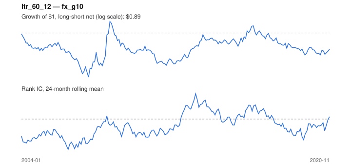

# Signal card: `ltr_60_12`

Negative 60-month return skipping the last 12 months. Universe: `fx_g10`, 2004-01 to 2020-11 (203 months), net of 10 bp per unit of turnover.

Verdict: **Not promoted** — passes 1 of 6 gates; fails ic_tstat, dsr, pbo, regimes, marginal.

## Why it should work

Investors over-extrapolate multi-year performance; long-run losers become too cheap and mean-revert.

Reference: De Bondt & Thaler (1985)

## Data and timing

- Uses returns through the end of month t; the forecast is month t+1's return.
- Source: Ken French data library (industry portfolios, factors), latest vintage.
- Parameters: `{'lookback': 60, 'skip': 12}`

## Results

| Metric | Value |
|---|---|
| Mean rank IC | -0.044 |
| IC t-stat (Newey-West) | -1.54 |
| IC information ratio (annual) | -0.35 |
| IC hit rate | 44% |
| Long-short return, annual, net | -0.3% |
| Long-short volatility, annual | 8.1% |
| Sharpe, gross / net | 0.02 / -0.04 |
| Sharpe since 2000, net | -0.04 |
| Probabilistic Sharpe (vs 0) | 0.43 |
| Deflated Sharpe (13 trials) | 0.02 |
| Turnover per month | 0.44 |
| Break-even cost | 3 bp |
| Quintile monotonicity | 0.50 |

IC decay (signal at t vs return k months later): 1m -0.044, 2m -0.019, 3m -0.025, 6m -0.044, 12m -0.039

Annual return by quantile: Q1 +0.2%, Q2 +0.6%, Q3 +0.4%

## Promotion gates (PRD §8.4)

| Gate | Threshold | Value | Result |
|---|---|---|---|
| IC t-stat | ≥ 2 | -1.54 | fail |
| Deflated Sharpe | ≥ 0.95 | 0.02 | fail |
| Family PBO | < 20% | 84% | fail |
| Regimes with IC > 0 | ≥ 3 of 4 | 1 of 4 | fail |
| Ensemble ICIR contribution | > 0 | -0.047 | fail |
| Economic rationale | reference | yes | pass |

IC by market regime: down_calm -0.153, down_volatile +0.008, up_calm -0.053, up_volatile -0.033

## Every configuration tried (`long_term_reversal` family)

PBO across 2 configurations: 84% over 203 common months.

| Configuration | IC | t-stat | Sharpe net | DSR |
|---|---|---|---|---|
| `ltr_36_12` | -0.029 | -0.98 | -0.01 | 0.02 |
| `ltr_60_12` | -0.044 | -1.54 | -0.04 | 0.02 |

## Tearsheet



## Where it breaks

- Worst drawdown: -26%, from Nov 2008 to Dec 2011.
- Worst 12 months: -17%, ending Dec 2009.
- Since 2000 the net Sharpe is -0.04 versus -0.04 over the full sample.

## Reproduce

```bash
uv run atlas ingest sdmx --agency ecb --agency oecd
uv run atlas research gates --universe fx_g10 --exclude-holdout
uv run atlas research signal ltr_60_12 --universe fx_g10
```

_Generated by `atlas research cards` on 2026-10-21. Do not edit by hand._
