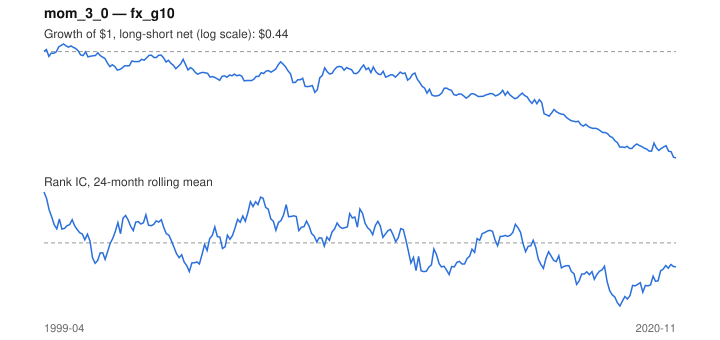

# Signal card: `mom_3_0`

3-month momentum skipping the last 0 month(s). Universe: `fx_g10`, 1999-04 to 2020-11 (260 months), net of 10 bp per unit of turnover.

Verdict: **Not promoted** — passes 2 of 6 gates; fails ic_tstat, dsr, regimes, marginal.

## Why it should work

Investors under-react to industry news, so prices drift in the direction of recent performance; Moskowitz & Grinblatt find industry momentum explains much of stock-level momentum.

Reference: Jegadeesh & Titman (1993); Moskowitz & Grinblatt (1999), industry momentum

## Data and timing

- Uses returns through the end of month t; the forecast is month t+1's return.
- Source: Ken French data library (industry portfolios, factors), latest vintage.
- Parameters: `{'lookback': 3, 'skip': 0}`

## Results

| Metric | Value |
|---|---|
| Mean rank IC | -0.011 |
| IC t-stat (Newey-West) | -0.40 |
| IC information ratio (annual) | -0.08 |
| IC hit rate | 50% |
| Long-short return, annual, net | -3.5% |
| Long-short volatility, annual | 7.8% |
| Sharpe, gross / net | -0.20 / -0.45 |
| Sharpe since 2000, net | -0.51 |
| Probabilistic Sharpe (vs 0) | 0.02 |
| Deflated Sharpe (13 trials) | 0.00 |
| Turnover per month | 1.64 |
| Break-even cost | -8 bp |
| Quintile monotonicity | -0.50 |

IC decay (signal at t vs return k months later): 1m -0.011, 2m -0.016, 3m -0.007, 6m +0.072, 12m -0.011

Annual return by quantile: Q1 +2.3%, Q2 +0.1%, Q3 +0.8%

## Promotion gates (PRD §8.4)

| Gate | Threshold | Value | Result |
|---|---|---|---|
| IC t-stat | ≥ 2 | -0.40 | fail |
| Deflated Sharpe | ≥ 0.95 | 0.00 | fail |
| Family PBO | < 20% | 12% | pass |
| Regimes with IC > 0 | ≥ 3 of 4 | 1 of 4 | fail |
| Ensemble ICIR contribution | > 0 | -0.006 | fail |
| Economic rationale | reference | yes | pass |

IC by market regime: down_calm -0.105, down_volatile -0.004, up_calm +0.007, up_volatile -0.038

## Every configuration tried (`momentum` family)

PBO across 5 configurations: 12% over 251 common months.

| Configuration | IC | t-stat | Sharpe net | DSR |
|---|---|---|---|---|
| `mom_12_1` | 0.027 | 0.95 | -0.05 | 0.01 |
| `mom_12_0` | 0.011 | 0.41 | -0.11 | 0.01 |
| `mom_6_0` | -0.008 | -0.31 | -0.28 | 0.00 |
| `mom_3_0` | -0.011 | -0.40 | -0.45 | 0.00 |
| `mom_1_0` | 0.001 | 0.04 | -0.52 | 0.00 |

## Tearsheet



## Where it breaks

- Worst drawdown: -59%, from Dec 1999 to Nov 2020.
- Worst 12 months: -18%, ending Jul 2008.
- Since 2000 the net Sharpe is -0.51 versus -0.45 over the full sample.

## Reproduce

```bash
uv run atlas ingest sdmx --agency ecb --agency oecd
uv run atlas research gates --universe fx_g10 --exclude-holdout
uv run atlas research signal mom_3_0 --universe fx_g10
```

_Generated by `atlas research cards` on 2026-10-21. Do not edit by hand._
