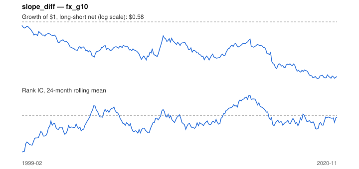

# Signal card: `slope_diff`

Local 10Y-3M slope minus the US one (steeper relative curve). Universe: `fx_g10`, 1999-02 to 2020-11 (261 months), net of 10 bp per unit of turnover.

Verdict: **Not promoted** — passes 1 of 6 gates; fails ic_tstat, dsr, pbo, regimes, marginal.

## Why it should work

No rationale recorded.

Reference: Ang & Chen (2010), yield curve predictors of foreign exchange returns

## Data and timing

- Uses returns through the end of month t; the forecast is month t+1's return.
- Source: Ken French data library (industry portfolios, factors), latest vintage.
- Parameters: `{'slope': 1}`

## Results

| Metric | Value |
|---|---|
| Mean rank IC | -0.051 |
| IC t-stat (Newey-West) | -1.98 |
| IC information ratio (annual) | -0.43 |
| IC hit rate | 44% |
| Long-short return, annual, net | -2.3% |
| Long-short volatility, annual | 6.6% |
| Sharpe, gross / net | -0.28 / -0.35 |
| Sharpe since 2000, net | -0.27 |
| Probabilistic Sharpe (vs 0) | 0.05 |
| Deflated Sharpe (13 trials) | 0.00 |
| Turnover per month | 0.37 |
| Break-even cost | -41 bp |
| Quintile monotonicity | -1.00 |

IC decay (signal at t vs return k months later): 1m -0.051, 2m -0.058, 3m -0.037, 6m -0.053, 12m -0.031

Annual return by quantile: Q1 +2.2%, Q2 +0.5%, Q3 +0.4%

## Promotion gates (PRD §8.4)

| Gate | Threshold | Value | Result |
|---|---|---|---|
| IC t-stat | ≥ 2 | -1.98 | fail |
| Deflated Sharpe | ≥ 0.95 | 0.00 | fail |
| Family PBO | < 20% | n/a | fail |
| Regimes with IC > 0 | ≥ 3 of 4 | 0 of 4 | fail |
| Ensemble ICIR contribution | > 0 | -0.141 | fail |
| Economic rationale | reference | yes | pass |

IC by market regime: down_calm -0.075, down_volatile -0.073, up_calm -0.002, up_volatile -0.116

## Every configuration tried (`curve_slope` family)

PBO across 1 configurations: n/a over 0 common months.

| Configuration | IC | t-stat | Sharpe net | DSR |
|---|---|---|---|---|
| `slope_diff` | -0.051 | -1.98 | -0.35 | 0.00 |

## Tearsheet



## Where it breaks

- Worst drawdown: -43%, from Feb 1999 to Jul 2019.
- Worst 12 months: -20%, ending Sep 2016.
- Since 2000 the net Sharpe is -0.27 versus -0.35 over the full sample.

## Reproduce

```bash
uv run atlas ingest sdmx --agency ecb --agency oecd
uv run atlas research gates --universe fx_g10 --exclude-holdout
uv run atlas research signal slope_diff --universe fx_g10
```

_Generated by `atlas research cards` on 2026-10-21. Do not edit by hand._
