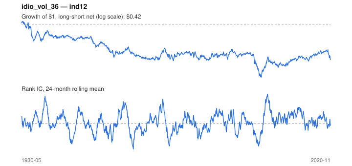

# Signal card: `idio_vol_36`

Negative 36-month residual volatility vs the universe average. Universe: `ind12`, 1930-05 to 2020-11 (1087 months), net of 10 bp per unit of turnover.

Verdict: **Not promoted** — passes 3 of 6 gates; fails ic_tstat, dsr, pbo.

## Why it should work

No rationale recorded.

Reference: Ang, Hodrick, Xing & Zhang (2006), the cross-section of volatility

## Data and timing

- Uses returns through the end of month t; the forecast is month t+1's return.
- Source: Ken French data library (industry portfolios, factors), latest vintage.
- Parameters: `{'window': 36}`

## Results

| Metric | Value |
|---|---|
| Mean rank IC | 0.007 |
| IC t-stat (Newey-West) | 0.75 |
| IC information ratio (annual) | 0.08 |
| IC hit rate | 50% |
| Long-short return, annual, net | -0.6% |
| Long-short volatility, annual | 7.8% |
| Sharpe, gross / net | -0.06 / -0.08 |
| Sharpe since 2000, net | 0.24 |
| Probabilistic Sharpe (vs 0) | 0.22 |
| Deflated Sharpe (57 trials) | 0.00 |
| Turnover per month | 0.16 |
| Break-even cost | -24 bp |
| Quintile monotonicity | -0.50 |

IC decay (signal at t vs return k months later): 1m +0.007, 2m +0.007, 3m +0.009, 6m +0.006, 12m +0.006

Annual return by quantile: Q1 +11.7%, Q2 +11.9%, Q3 +11.2%

## Promotion gates (PRD §8.4)

| Gate | Threshold | Value | Result |
|---|---|---|---|
| IC t-stat | ≥ 2 | 0.75 | fail |
| Deflated Sharpe | ≥ 0.95 | 0.00 | fail |
| Family PBO | < 20% | 92% | fail |
| Regimes with IC > 0 | ≥ 3 of 4 | 3 of 4 | pass |
| Ensemble ICIR contribution | > 0 | +0.011 | pass |
| Economic rationale | reference | yes | pass |

IC by market regime: down_calm -0.031, down_volatile +0.047, up_calm +0.006, up_volatile +0.008

## Every configuration tried (`idiosyncratic_vol` family)

PBO across 3 configurations: 92% over 1055 common months.

| Configuration | IC | t-stat | Sharpe net | DSR |
|---|---|---|---|---|
| `idio_vol_60` | 0.009 | 0.92 | -0.06 | 0.00 |
| `idio_vol_36` | 0.007 | 0.75 | -0.08 | 0.00 |
| `idio_vol_24` | 0.006 | 0.65 | -0.10 | 0.00 |

## Tearsheet



## Where it breaks

- Worst drawdown: -74%, from Aug 1930 to Jul 2000.
- Worst 12 months: -28%, ending Jan 1934.
- Since 2000 the net Sharpe is 0.24 versus -0.08 over the full sample.

## Reproduce

```bash
uv run atlas ingest kenfrench --all
uv run atlas research gates --universe ind12 --exclude-holdout
uv run atlas research signal idio_vol_36 --universe ind12
```

_Generated by `atlas research cards` on 2026-10-21. Do not edit by hand._
