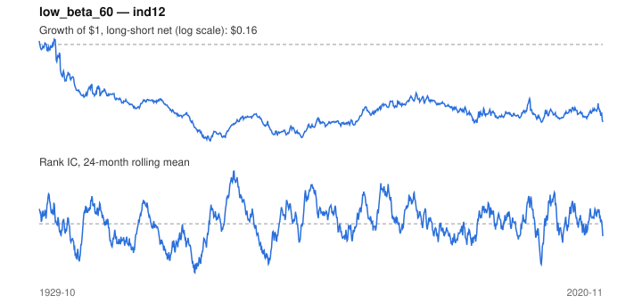

# Signal card: `low_beta_60`

Negative 60-month beta to the universe average (betting against beta). Universe: `ind12`, 1929-10 to 2020-11 (1094 months), net of 10 bp per unit of turnover.

Verdict: **Not promoted** — passes 2 of 6 gates; fails ic_tstat, dsr, pbo, marginal.

## Why it should work

No rationale recorded.

Reference: Frazzini & Pedersen (2014), betting against beta

## Data and timing

- Uses returns through the end of month t; the forecast is month t+1's return.
- Source: Ken French data library (industry portfolios, factors), latest vintage.
- Parameters: `{'window': 60}`

## Results

| Metric | Value |
|---|---|
| Mean rank IC | 0.005 |
| IC t-stat (Newey-West) | 0.32 |
| IC information ratio (annual) | 0.04 |
| IC hit rate | 51% |
| Long-short return, annual, net | -1.1% |
| Long-short volatility, annual | 13.0% |
| Sharpe, gross / net | -0.07 / -0.09 |
| Sharpe since 2000, net | 0.05 |
| Probabilistic Sharpe (vs 0) | 0.20 |
| Deflated Sharpe (57 trials) | 0.00 |
| Turnover per month | 0.12 |
| Break-even cost | -67 bp |
| Quintile monotonicity | -1.00 |

IC decay (signal at t vs return k months later): 1m +0.005, 2m +0.003, 3m +0.002, 6m +0.000, 12m -0.004

Annual return by quantile: Q1 +11.9%, Q2 +11.8%, Q3 +11.0%

## Promotion gates (PRD §8.4)

| Gate | Threshold | Value | Result |
|---|---|---|---|
| IC t-stat | ≥ 2 | 0.32 | fail |
| Deflated Sharpe | ≥ 0.95 | 0.00 | fail |
| Family PBO | < 20% | 62% | fail |
| Regimes with IC > 0 | ≥ 3 of 4 | 3 of 4 | pass |
| Ensemble ICIR contribution | > 0 | -0.035 | fail |
| Economic rationale | reference | yes | pass |

IC by market regime: down_calm +0.034, down_volatile +0.042, up_calm +0.058, up_volatile -0.016

## Every configuration tried (`low_beta` family)

PBO across 2 configurations: 62% over 1094 common months.

| Configuration | IC | t-stat | Sharpe net | DSR |
|---|---|---|---|---|
| `low_beta_36` | 0.004 | 0.24 | -0.08 | 0.00 |
| `low_beta_60` | 0.005 | 0.32 | -0.09 | 0.00 |

## Tearsheet



## Where it breaks

- Worst drawdown: -91%, from Mar 1932 to Jun 1957.
- Worst 12 months: -56%, ending May 1933.
- Since 2000 the net Sharpe is 0.05 versus -0.09 over the full sample.

## Reproduce

```bash
uv run atlas ingest kenfrench --all
uv run atlas research gates --universe ind12 --exclude-holdout
uv run atlas research signal low_beta_60 --universe ind12
```

_Generated by `atlas research cards` on 2026-10-21. Do not edit by hand._
