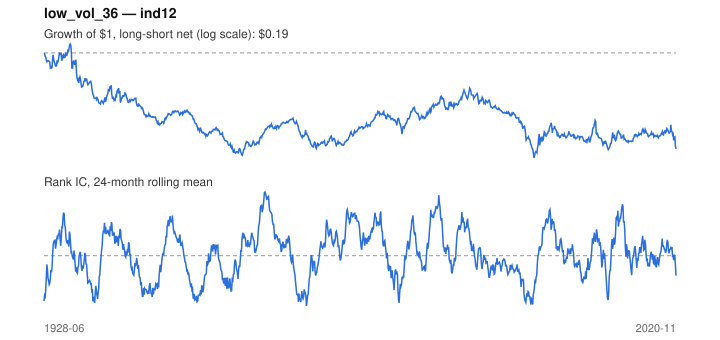

# Signal card: `low_vol_36`

Negative trailing 36-month volatility. Universe: `ind12`, 1928-06 to 2020-11 (1110 months), net of 10 bp per unit of turnover.

Verdict: **Not promoted** — passes 2 of 6 gates; fails ic_tstat, dsr, pbo, marginal.

## Why it should work

Leverage-constrained investors bid up high-beta, high-volatility assets, leaving low-volatility assets with higher risk-adjusted returns.

Reference: Ang, Hodrick, Xing & Zhang (2006); Frazzini & Pedersen (2014)

## Data and timing

- Uses returns through the end of month t; the forecast is month t+1's return.
- Source: Ken French data library (industry portfolios, factors), latest vintage.
- Parameters: `{'window': 36}`

## Results

| Metric | Value |
|---|---|
| Mean rank IC | 0.007 |
| IC t-stat (Newey-West) | 0.51 |
| IC information ratio (annual) | 0.06 |
| IC hit rate | 50% |
| Long-short return, annual, net | -1.0% |
| Long-short volatility, annual | 12.3% |
| Sharpe, gross / net | -0.06 / -0.08 |
| Sharpe since 2000, net | 0.08 |
| Probabilistic Sharpe (vs 0) | 0.22 |
| Deflated Sharpe (57 trials) | 0.00 |
| Turnover per month | 0.21 |
| Break-even cost | -31 bp |
| Quintile monotonicity | -0.50 |

IC decay (signal at t vs return k months later): 1m +0.007, 2m +0.005, 3m +0.006, 6m +0.004, 12m +0.002

Annual return by quantile: Q1 +11.8%, Q2 +12.3%, Q3 +11.0%

## Promotion gates (PRD §8.4)

| Gate | Threshold | Value | Result |
|---|---|---|---|
| IC t-stat | ≥ 2 | 0.51 | fail |
| Deflated Sharpe | ≥ 0.95 | 0.00 | fail |
| Family PBO | < 20% | 81% | fail |
| Regimes with IC > 0 | ≥ 3 of 4 | 3 of 4 | pass |
| Ensemble ICIR contribution | > 0 | -0.029 | fail |
| Economic rationale | reference | yes | pass |

IC by market regime: down_calm +0.038, down_volatile +0.069, up_calm +0.035, up_volatile -0.024

## Every configuration tried (`low_volatility` family)

PBO across 4 configurations: 81% over 1094 common months.

| Configuration | IC | t-stat | Sharpe net | DSR |
|---|---|---|---|---|
| `low_vol_60` | 0.007 | 0.52 | -0.07 | 0.00 |
| `low_vol_36` | 0.007 | 0.51 | -0.08 | 0.00 |
| `low_vol_12` | 0.007 | 0.53 | -0.11 | 0.00 |
| `low_vol_24` | 0.008 | 0.61 | -0.16 | 0.00 |

## Tearsheet



## Where it breaks

- Worst drawdown: -86%, from Apr 1932 to Feb 2000.
- Worst 12 months: -45%, ending May 1933.
- Since 2000 the net Sharpe is 0.08 versus -0.08 over the full sample.

## Reproduce

```bash
uv run atlas ingest kenfrench --all
uv run atlas research gates --universe ind12 --exclude-holdout
uv run atlas research signal low_vol_36 --universe ind12
```

_Generated by `atlas research cards` on 2026-10-21. Do not edit by hand._
