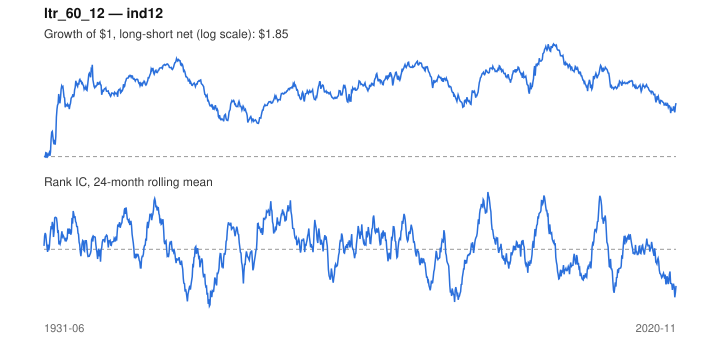

# Signal card: `ltr_60_12`

Negative 60-month return skipping the last 12 months. Universe: `ind12`, 1931-06 to 2020-11 (1074 months), net of 10 bp per unit of turnover.

Verdict: **Not promoted** — passes 2 of 6 gates; fails ic_tstat, dsr, pbo, regimes.

## Why it should work

Investors over-extrapolate multi-year performance; long-run losers become too cheap and mean-revert.

Reference: De Bondt & Thaler (1985)

## Data and timing

- Uses returns through the end of month t; the forecast is month t+1's return.
- Source: Ken French data library (industry portfolios, factors), latest vintage.
- Parameters: `{'lookback': 60, 'skip': 12}`

## Results

| Metric | Value |
|---|---|
| Mean rank IC | 0.009 |
| IC t-stat (Newey-West) | 0.67 |
| IC information ratio (annual) | 0.08 |
| IC hit rate | 50% |
| Long-short return, annual, net | 1.2% |
| Long-short volatility, annual | 10.3% |
| Sharpe, gross / net | 0.16 / 0.12 |
| Sharpe since 2000, net | -0.04 |
| Probabilistic Sharpe (vs 0) | 0.87 |
| Deflated Sharpe (57 trials) | 0.00 |
| Turnover per month | 0.37 |
| Break-even cost | 38 bp |
| Quintile monotonicity | 1.00 |

IC decay (signal at t vs return k months later): 1m +0.009, 2m +0.013, 3m +0.015, 6m +0.016, 12m +0.017

Annual return by quantile: Q1 +11.3%, Q2 +12.2%, Q3 +13.0%

## Promotion gates (PRD §8.4)

| Gate | Threshold | Value | Result |
|---|---|---|---|
| IC t-stat | ≥ 2 | 0.67 | fail |
| Deflated Sharpe | ≥ 0.95 | 0.00 | fail |
| Family PBO | < 20% | 86% | fail |
| Regimes with IC > 0 | ≥ 3 of 4 | 2 of 4 | fail |
| Ensemble ICIR contribution | > 0 | +0.025 | pass |
| Economic rationale | reference | yes | pass |

IC by market regime: down_calm +0.045, down_volatile +0.057, up_calm -0.044, up_volatile -0.010

## Every configuration tried (`long_term_reversal` family)

PBO across 3 configurations: 86% over 1074 common months.

| Configuration | IC | t-stat | Sharpe net | DSR |
|---|---|---|---|---|
| `ltr_36_12` | 0.013 | 1.00 | 0.19 | 0.00 |
| `ltr_60_12` | 0.009 | 0.67 | 0.12 | 0.00 |
| `ltr_60_0` | -0.019 | -1.55 | -0.09 | 0.00 |

## Tearsheet



## Where it breaks

- Worst drawdown: -55%, from Jul 2003 to Feb 2020.
- Worst 12 months: -22%, ending Jan 1935.
- Since 2000 the net Sharpe is -0.04 versus 0.12 over the full sample.

## Reproduce

```bash
uv run atlas ingest kenfrench --all
uv run atlas research gates --universe ind12 --exclude-holdout
uv run atlas research signal ltr_60_12 --universe ind12
```

_Generated by `atlas research cards` on 2026-10-21. Do not edit by hand._
