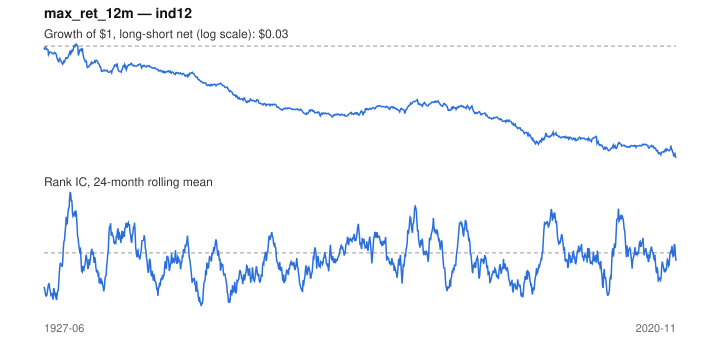

# Signal card: `max_ret_12m`

Negative maximum monthly return over 12 months (avoid lotteries). Universe: `ind12`, 1927-06 to 2020-11 (1122 months), net of 10 bp per unit of turnover.

Verdict: **Not promoted** — passes 1 of 6 gates; fails ic_tstat, dsr, pbo, regimes, marginal.

## Why it should work

No rationale recorded.

Reference: Bali, Cakici & Whitelaw (2011), maxing out

## Data and timing

- Uses returns through the end of month t; the forecast is month t+1's return.
- Source: Ken French data library (industry portfolios, factors), latest vintage.
- Parameters: `{'months': 12}`

## Results

| Metric | Value |
|---|---|
| Mean rank IC | -0.024 |
| IC t-stat (Newey-West) | -1.95 |
| IC information ratio (annual) | -0.21 |
| IC hit rate | 46% |
| Long-short return, annual, net | -3.1% |
| Long-short volatility, annual | 10.7% |
| Sharpe, gross / net | -0.24 / -0.29 |
| Sharpe since 2000, net | -0.14 |
| Probabilistic Sharpe (vs 0) | 0.00 |
| Deflated Sharpe (57 trials) | 0.00 |
| Turnover per month | 0.39 |
| Break-even cost | -56 bp |
| Quintile monotonicity | -1.00 |

IC decay (signal at t vs return k months later): 1m -0.024, 2m -0.025, 3m -0.023, 6m -0.017, 12m -0.004

Annual return by quantile: Q1 +13.6%, Q2 +11.2%, Q3 +11.0%

## Promotion gates (PRD §8.4)

| Gate | Threshold | Value | Result |
|---|---|---|---|
| IC t-stat | ≥ 2 | -1.95 | fail |
| Deflated Sharpe | ≥ 0.95 | 0.00 | fail |
| Family PBO | < 20% | 77% | fail |
| Regimes with IC > 0 | ≥ 3 of 4 | 1 of 4 | fail |
| Ensemble ICIR contribution | > 0 | -0.067 | fail |
| Economic rationale | reference | yes | pass |

IC by market regime: down_calm -0.063, down_volatile +0.053, up_calm -0.020, up_volatile -0.022

## Every configuration tried (`lottery` family)

PBO across 2 configurations: 77% over 1122 common months.

| Configuration | IC | t-stat | Sharpe net | DSR |
|---|---|---|---|---|
| `max_ret_12m` | -0.024 | -1.95 | -0.29 | 0.00 |
| `max_ret_6m` | -0.021 | -1.82 | -0.31 | 0.00 |

## Tearsheet



## Where it breaks

- Worst drawdown: -97%, from Mar 1932 to Nov 2020.
- Worst 12 months: -42%, ending Nov 1933.
- Since 2000 the net Sharpe is -0.14 versus -0.29 over the full sample.

## Reproduce

```bash
uv run atlas ingest kenfrench --all
uv run atlas research gates --universe ind12 --exclude-holdout
uv run atlas research signal max_ret_12m --universe ind12
```

_Generated by `atlas research cards` on 2026-10-21. Do not edit by hand._
