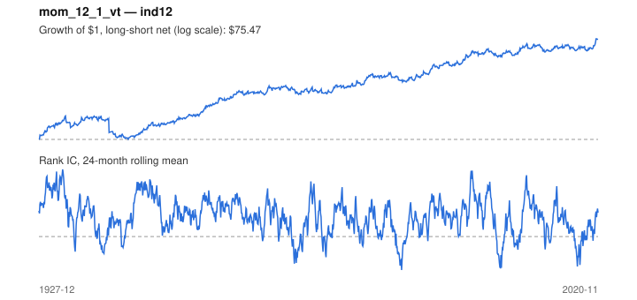

# Signal card: `mom_12_1_vt`

12-1 momentum, long-short scaled to 12% trailing volatility. Universe: `ind12`, 1927-12 to 2020-11 (1116 months), net of 10 bp per unit of turnover.

Verdict: **Not promoted** — passes 5 of 6 gates; fails dsr.

## Why it should work

Investors under-react to industry news, so prices drift in the direction of recent performance; Moskowitz & Grinblatt find industry momentum explains much of stock-level momentum.

Reference: Barroso & Santa-Clara (2015), momentum has its moments

## Data and timing

- Uses returns through the end of month t; the forecast is month t+1's return.
- Source: Ken French data library (industry portfolios, factors), latest vintage.
- Parameters: `{'lookback': 12, 'skip': 1, 'vol_target': 0.12}`; volatility target 12%

## Results

| Metric | Value |
|---|---|
| Mean rank IC | 0.070 |
| IC t-stat (Newey-West) | 6.14 |
| IC information ratio (annual) | 0.60 |
| IC hit rate | 56% |
| Long-short return, annual, net | 5.8% |
| Long-short volatility, annual | 15.0% |
| Sharpe, gross / net | 0.48 / 0.39 |
| Sharpe since 2000, net | 0.26 |
| Probabilistic Sharpe (vs 0) | 1.00 |
| Deflated Sharpe (57 trials) | 0.04 |
| Turnover per month | 1.02 |
| Break-even cost | 59 bp |
| Quintile monotonicity | 1.00 |

IC decay (signal at t vs return k months later): 1m +0.070, 2m +0.065, 3m +0.053, 6m +0.038, 12m -0.021

Annual return by quantile: Q1 +9.6%, Q2 +11.8%, Q3 +14.5%

## Promotion gates (PRD §8.4)

| Gate | Threshold | Value | Result |
|---|---|---|---|
| IC t-stat | ≥ 2 | 6.14 | pass |
| Deflated Sharpe | ≥ 0.95 | 0.04 | fail |
| Family PBO | < 20% | 2% | pass |
| Regimes with IC > 0 | ≥ 3 of 4 | 4 of 4 | pass |
| Ensemble ICIR contribution | > 0 | +0.094 | pass |
| Economic rationale | reference | yes | pass |

IC by market regime: down_calm +0.097, down_volatile +0.021, up_calm +0.056, up_volatile +0.064

## Every configuration tried (`momentum` family)

PBO across 12 configurations: 2% over 1110 common months.

| Configuration | IC | t-stat | Sharpe net | DSR |
|---|---|---|---|---|
| `mom_12_0` | 0.085 | 7.60 | 0.42 | 0.08 |
| `mom_12_1` | 0.070 | 6.14 | 0.33 | 0.01 |
| `mom_6_0` | 0.070 | 6.13 | 0.31 | 0.00 |
| `mom_9_0` | 0.069 | 6.11 | 0.30 | 0.00 |
| `mom_3_0` | 0.061 | 5.35 | 0.28 | 0.00 |
| `mom_18_0` | 0.060 | 5.63 | 0.21 | 0.00 |
| `mom_9_1` | 0.049 | 4.30 | 0.19 | 0.00 |
| `mom_24_0` | 0.051 | 4.38 | 0.14 | 0.00 |
| `mom_6_1` | 0.045 | 3.76 | 0.11 | 0.00 |
| `mom_18_1` | 0.043 | 3.95 | 0.10 | 0.00 |
| `mom_24_1` | 0.036 | 3.11 | 0.04 | 0.00 |
| `mom_3_1` | 0.016 | 1.40 | -0.17 | 0.00 |

## Tearsheet



## Where it breaks

- Worst drawdown: -63%, from May 1932 to Oct 1942.
- Worst 12 months: -49%, ending Jul 1940.
- Since 2000 the net Sharpe is 0.26 versus 0.39 over the full sample.

## Reproduce

```bash
uv run atlas ingest kenfrench --all
uv run atlas research gates --universe ind12 --exclude-holdout
uv run atlas research signal mom_12_1_vt --universe ind12
```

_Generated by `atlas research cards` on 2026-10-21. Do not edit by hand._
