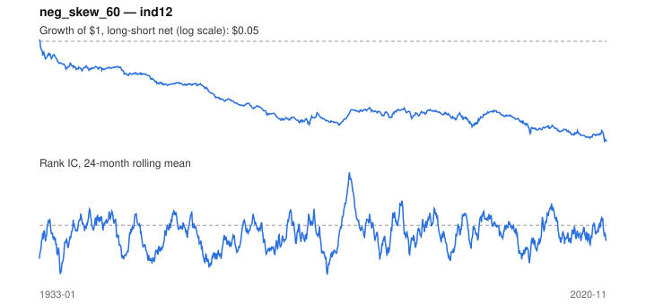

# Signal card: `neg_skew_60`

Negative 60-month return skewness. Universe: `ind12`, 1933-01 to 2020-11 (1055 months), net of 10 bp per unit of turnover.

Verdict: **Not promoted** — passes 1 of 6 gates; fails ic_tstat, dsr, pbo, regimes, marginal.

## Why it should work

No rationale recorded.

Reference: Harvey & Siddique (2000); Amaya et al. (2015) on realized skewness

## Data and timing

- Uses returns through the end of month t; the forecast is month t+1's return.
- Source: Ken French data library (industry portfolios, factors), latest vintage.
- Parameters: `{'window': 60}`

## Results

| Metric | Value |
|---|---|
| Mean rank IC | -0.041 |
| IC t-stat (Newey-West) | -3.60 |
| IC information ratio (annual) | -0.42 |
| IC hit rate | 44% |
| Long-short return, annual, net | -3.0% |
| Long-short volatility, annual | 9.1% |
| Sharpe, gross / net | -0.29 / -0.32 |
| Sharpe since 2000, net | -0.19 |
| Probabilistic Sharpe (vs 0) | 0.00 |
| Deflated Sharpe (57 trials) | 0.00 |
| Turnover per month | 0.28 |
| Break-even cost | -78 bp |
| Quintile monotonicity | -1.00 |

IC decay (signal at t vs return k months later): 1m -0.041, 2m -0.042, 3m -0.041, 6m -0.044, 12m -0.018

Annual return by quantile: Q1 +14.2%, Q2 +12.5%, Q3 +11.6%

## Promotion gates (PRD §8.4)

| Gate | Threshold | Value | Result |
|---|---|---|---|
| IC t-stat | ≥ 2 | -3.60 | fail |
| Deflated Sharpe | ≥ 0.95 | 0.00 | fail |
| Family PBO | < 20% | 43% | fail |
| Regimes with IC > 0 | ≥ 3 of 4 | 0 of 4 | fail |
| Ensemble ICIR contribution | > 0 | -0.088 | fail |
| Economic rationale | reference | yes | pass |

IC by market regime: down_calm -0.114, down_volatile -0.003, up_calm -0.061, up_volatile -0.008

## Every configuration tried (`skewness` family)

PBO across 2 configurations: 43% over 1055 common months.

| Configuration | IC | t-stat | Sharpe net | DSR |
|---|---|---|---|---|
| `neg_skew_36` | -0.030 | -2.61 | -0.24 | 0.00 |
| `neg_skew_60` | -0.041 | -3.60 | -0.32 | 0.00 |

## Tearsheet



## Where it breaks

- Worst drawdown: -95%, from Jan 1933 to Nov 2020.
- Worst 12 months: -42%, ending Jan 1934.
- Since 2000 the net Sharpe is -0.19 versus -0.32 over the full sample.

## Reproduce

```bash
uv run atlas ingest kenfrench --all
uv run atlas research gates --universe ind12 --exclude-holdout
uv run atlas research signal neg_skew_60 --universe ind12
```

_Generated by `atlas research cards` on 2026-10-21. Do not edit by hand._
