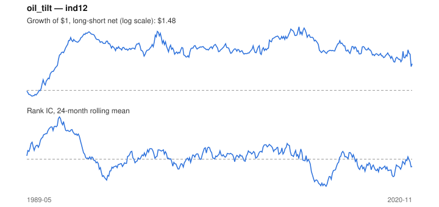

# Signal card: `oil_tilt`

Sensitivity to oil (60-month beta) times its 3-month move. Universe: `ind12`, 1989-05 to 2020-11 (379 months), net of 10 bp per unit of turnover.

Verdict: **Not promoted** — passes 4 of 6 gates; fails ic_tstat, dsr.

## Why it should work

No rationale recorded.

Reference: PRD §6.4 macro-to-sector sensitivity; Moskowitz, Ooi & Pedersen (2012) on trend persistence

## Data and timing

- Uses returns through the end of month t; the forecast is month t+1's return.
- Source: Ken French data library (industry portfolios, factors), latest vintage.
- Parameters: `{'window': 60, 'trend': 3}`

## Results

| Metric | Value |
|---|---|
| Mean rank IC | 0.018 |
| IC t-stat (Newey-West) | 0.80 |
| IC information ratio (annual) | 0.15 |
| IC hit rate | 50% |
| Long-short return, annual, net | 2.0% |
| Long-short volatility, annual | 12.1% |
| Sharpe, gross / net | 0.27 / 0.16 |
| Sharpe since 2000, net | -0.08 |
| Probabilistic Sharpe (vs 0) | 0.82 |
| Deflated Sharpe (57 trials) | 0.01 |
| Turnover per month | 1.08 |
| Break-even cost | 25 bp |
| Quintile monotonicity | 1.00 |

IC decay (signal at t vs return k months later): 1m +0.018, 2m +0.016, 3m -0.010, 6m -0.017, 12m -0.026

Annual return by quantile: Q1 +10.3%, Q2 +10.5%, Q3 +13.6%

## Promotion gates (PRD §8.4)

| Gate | Threshold | Value | Result |
|---|---|---|---|
| IC t-stat | ≥ 2 | 0.80 | fail |
| Deflated Sharpe | ≥ 0.95 | 0.01 | fail |
| Family PBO | < 20% | 9% | pass |
| Regimes with IC > 0 | ≥ 3 of 4 | 3 of 4 | pass |
| Ensemble ICIR contribution | > 0 | +0.029 | pass |
| Economic rationale | reference | yes | pass |

IC by market regime: down_calm -0.015, down_volatile +0.001, up_calm +0.023, up_volatile +0.025

## Every configuration tried (`oil_tilt` family)

PBO across 4 configurations: 9% over 379 common months.

| Configuration | IC | t-stat | Sharpe net | DSR |
|---|---|---|---|---|
| `oil_tilt` | 0.018 | 0.80 | 0.16 | 0.01 |
| `oil_tilt_36_3` | 0.018 | 0.85 | 0.11 | 0.00 |
| `oil_tilt_60_1` | 0.004 | 0.18 | -0.08 | 0.00 |
| `oil_tilt_36_1` | 0.005 | 0.23 | -0.16 | 0.00 |

## Tearsheet



## Where it breaks

- Worst drawdown: -44%, from Aug 2011 to Oct 2020.
- Worst 12 months: -23%, ending Jun 2013.
- Since 2000 the net Sharpe is -0.08 versus 0.16 over the full sample.

## Reproduce

```bash
uv run atlas ingest kenfrench --all
uv run atlas research gates --universe ind12 --exclude-holdout
uv run atlas research signal oil_tilt --universe ind12
```

_Generated by `atlas research cards` on 2026-10-21. Do not edit by hand._
