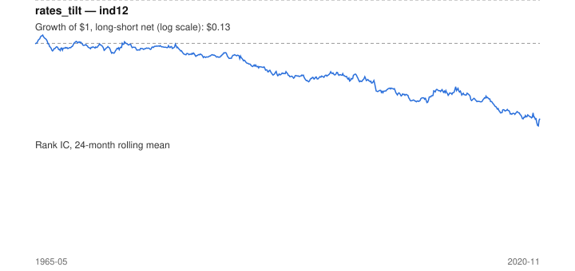

# Signal card: `rates_tilt`

Sensitivity to the 10-year yield (60-month beta) times its 3-month move. Universe: `ind12`, 1965-05 to 2020-11 (657 months), net of 10 bp per unit of turnover.

Verdict: **Not promoted** — passes 2 of 6 gates; fails ic_tstat, dsr, pbo, regimes.

## Why it should work

No rationale recorded.

Reference: PRD §6.4 macro-to-sector sensitivity; Moskowitz, Ooi & Pedersen (2012) on trend persistence

## Data and timing

- Uses returns through the end of month t; the forecast is month t+1's return.
- Source: Ken French data library (industry portfolios, factors), latest vintage.
- Parameters: `{'window': 60, 'trend': 3}`

## Results

| Metric | Value |
|---|---|
| Mean rank IC | -0.008 |
| IC t-stat (Newey-West) | -0.48 |
| IC information ratio (annual) | -0.07 |
| IC hit rate | 50% |
| Long-short return, annual, net | -3.1% |
| Long-short volatility, annual | 10.9% |
| Sharpe, gross / net | -0.17 / -0.28 |
| Sharpe since 2000, net | -0.31 |
| Probabilistic Sharpe (vs 0) | 0.02 |
| Deflated Sharpe (57 trials) | 0.00 |
| Turnover per month | 1.07 |
| Break-even cost | -14 bp |
| Quintile monotonicity | -1.00 |

IC decay (signal at t vs return k months later): 1m +nan, 2m +nan, 3m +nan, 6m +nan, 12m +nan

Annual return by quantile: Q1 +12.6%, Q2 +11.3%, Q3 +10.8%

## Promotion gates (PRD §8.4)

| Gate | Threshold | Value | Result |
|---|---|---|---|
| IC t-stat | ≥ 2 | -0.48 | fail |
| Deflated Sharpe | ≥ 0.95 | 0.00 | fail |
| Family PBO | < 20% | 41% | fail |
| Regimes with IC > 0 | ≥ 3 of 4 | 1 of 4 | fail |
| Ensemble ICIR contribution | > 0 | +0.003 | pass |
| Economic rationale | reference | yes | pass |

IC by market regime: down_calm +0.014, down_volatile +nan, up_calm +nan, up_volatile +nan

## Every configuration tried (`rates_tilt` family)

PBO across 4 configurations: 41% over 649 common months.

| Configuration | IC | t-stat | Sharpe net | DSR |
|---|---|---|---|---|
| `rates_tilt_60_1` | 0.025 | 1.53 | -0.16 | 0.00 |
| `rates_tilt_36_1` | 0.020 | 1.31 | -0.21 | 0.00 |
| `rates_tilt` | -0.008 | -0.48 | -0.28 | 0.00 |
| `rates_tilt_36_3` | -0.010 | -0.59 | -0.34 | 0.00 |

## Tearsheet



## Where it breaks

- Worst drawdown: -91%, from Mar 1966 to Sep 2020.
- Worst 12 months: -33%, ending Mar 1967.
- Since 2000 the net Sharpe is -0.31 versus -0.28 over the full sample.

## Reproduce

```bash
uv run atlas ingest kenfrench --all
uv run atlas research gates --universe ind12 --exclude-holdout
uv run atlas research signal rates_tilt --universe ind12
```

_Generated by `atlas research cards` on 2026-10-21. Do not edit by hand._
