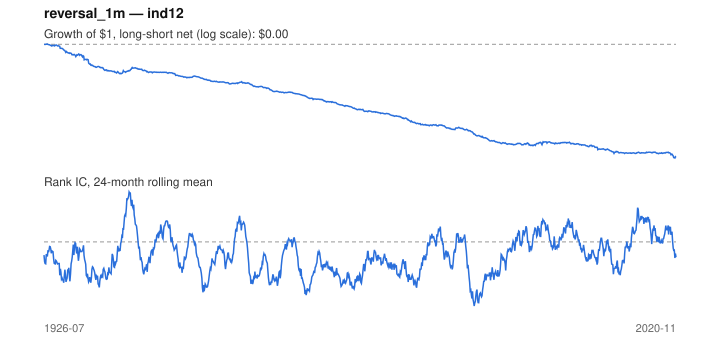

# Signal card: `reversal_1m`

Short-term reversal: negative last 1-month return. Universe: `ind12`, 1926-07 to 2020-11 (1133 months), net of 10 bp per unit of turnover.

Verdict: **Not promoted** — passes 1 of 6 gates; fails ic_tstat, dsr, pbo, regimes, marginal.

## Why it should work

At the stock level, last month's losers bounce back (liquidity provision). At the industry level the effect is weaker and usually flips to continuation.

Reference: Jegadeesh (1990); Lehmann (1990)

## Data and timing

- Uses returns through the end of month t; the forecast is month t+1's return.
- Source: Ken French data library (industry portfolios, factors), latest vintage.
- Parameters: `{'months': 1}`

## Results

| Metric | Value |
|---|---|
| Mean rank IC | -0.074 |
| IC t-stat (Newey-West) | -5.68 |
| IC information ratio (annual) | -0.66 |
| IC hit rate | 41% |
| Long-short return, annual, net | -9.2% |
| Long-short volatility, annual | 11.0% |
| Sharpe, gross / net | -0.56 / -0.83 |
| Sharpe since 2000, net | -0.37 |
| Probabilistic Sharpe (vs 0) | 0.00 |
| Deflated Sharpe (57 trials) | 0.00 |
| Turnover per month | 2.50 |
| Break-even cost | -21 bp |
| Quintile monotonicity | -1.00 |

IC decay (signal at t vs return k months later): 1m -0.074, 2m -0.015, 3m -0.009, 6m -0.024, 12m -0.041

Annual return by quantile: Q1 +15.1%, Q2 +12.0%, Q3 +8.9%

## Promotion gates (PRD §8.4)

| Gate | Threshold | Value | Result |
|---|---|---|---|
| IC t-stat | ≥ 2 | -5.68 | fail |
| Deflated Sharpe | ≥ 0.95 | 0.00 | fail |
| Family PBO | < 20% | 67% | fail |
| Regimes with IC > 0 | ≥ 3 of 4 | 0 of 4 | fail |
| Ensemble ICIR contribution | > 0 | -0.150 | fail |
| Economic rationale | reference | yes | pass |

IC by market regime: down_calm -0.038, down_volatile -0.043, up_calm -0.045, up_volatile -0.117

## Every configuration tried (`reversal` family)

PBO across 3 configurations: 67% over 1131 common months.

| Configuration | IC | t-stat | Sharpe net | DSR |
|---|---|---|---|---|
| `reversal_3m` | -0.061 | -5.35 | -0.58 | 0.00 |
| `reversal_2m` | -0.057 | -4.91 | -0.62 | 0.00 |
| `reversal_1m` | -0.074 | -5.68 | -0.83 | 0.00 |

## Tearsheet



## Where it breaks

- Worst drawdown: -100%, from Jan 1927 to Sep 2020.
- Worst 12 months: -50%, ending May 1933.
- Since 2000 the net Sharpe is -0.37 versus -0.83 over the full sample.

## Reproduce

```bash
uv run atlas ingest kenfrench --all
uv run atlas research gates --universe ind12 --exclude-holdout
uv run atlas research signal reversal_1m --universe ind12
```

_Generated by `atlas research cards` on 2026-10-21. Do not edit by hand._
