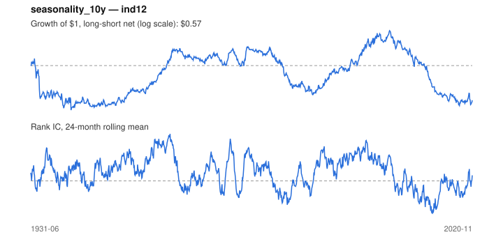

# Signal card: `seasonality_10y`

Average return in the coming calendar month over the past 10 years. Universe: `ind12`, 1931-06 to 2020-11 (1074 months), net of 10 bp per unit of turnover.

Verdict: **Not promoted** — passes 4 of 6 gates; fails dsr, pbo.

## Why it should work

No rationale recorded.

Reference: Heston & Sadka (2008), seasonality in the cross-section of returns

## Data and timing

- Uses returns through the end of month t; the forecast is month t+1's return.
- Source: Ken French data library (industry portfolios, factors), latest vintage.
- Parameters: `{'years': 10}`

## Results

| Metric | Value |
|---|---|
| Mean rank IC | 0.044 |
| IC t-stat (Newey-West) | 3.84 |
| IC information ratio (annual) | 0.43 |
| IC hit rate | 56% |
| Long-short return, annual, net | -0.2% |
| Long-short volatility, annual | 9.6% |
| Sharpe, gross / net | 0.29 / -0.02 |
| Sharpe since 2000, net | -0.38 |
| Probabilistic Sharpe (vs 0) | 0.44 |
| Deflated Sharpe (57 trials) | 0.00 |
| Turnover per month | 2.47 |
| Break-even cost | 9 bp |
| Quintile monotonicity | 1.00 |

IC decay (signal at t vs return k months later): 1m +0.044, 2m +0.001, 3m -0.025, 6m -0.016, 12m +0.020

Annual return by quantile: Q1 +10.8%, Q2 +12.1%, Q3 +13.6%

## Promotion gates (PRD §8.4)

| Gate | Threshold | Value | Result |
|---|---|---|---|
| IC t-stat | ≥ 2 | 3.84 | pass |
| Deflated Sharpe | ≥ 0.95 | 0.00 | fail |
| Family PBO | < 20% | 25% | fail |
| Regimes with IC > 0 | ≥ 3 of 4 | 3 of 4 | pass |
| Ensemble ICIR contribution | > 0 | +0.072 | pass |
| Economic rationale | reference | yes | pass |

IC by market regime: down_calm -0.008, down_volatile +0.033, up_calm +0.014, up_volatile +0.053

## Every configuration tried (`seasonality` family)

PBO across 3 configurations: 25% over 1014 common months.

| Configuration | IC | t-stat | Sharpe net | DSR |
|---|---|---|---|---|
| `seasonality_20y` | 0.063 | 5.77 | 0.18 | 0.00 |
| `seasonality_10y` | 0.044 | 3.84 | -0.02 | 0.00 |
| `seasonality_5y` | 0.040 | 3.45 | -0.07 | 0.00 |

## Tearsheet



## Where it breaks

- Worst drawdown: -70%, from Feb 2004 to Apr 2018.
- Worst 12 months: -40%, ending Apr 1933.
- Since 2000 the net Sharpe is -0.38 versus -0.02 over the full sample.

## Reproduce

```bash
uv run atlas ingest kenfrench --all
uv run atlas research gates --universe ind12 --exclude-holdout
uv run atlas research signal seasonality_10y --universe ind12
```

_Generated by `atlas research cards` on 2026-10-21. Do not edit by hand._
