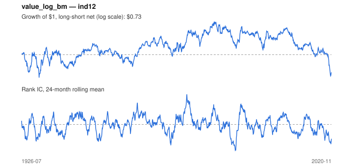

# Signal card: `value_log_bm`

Log book-to-market (cheap industries score high). Universe: `ind12`, 1926-07 to 2020-11 (1133 months), net of 10 bp per unit of turnover.

Verdict: **Not promoted** — passes 1 of 6 gates; fails ic_tstat, dsr, pbo, regimes, marginal.

## Why it should work

Cheap assets (high book-to-market) earn a premium, as compensation for distress risk or because investors over-extrapolate growth.

Reference: Fama & French (1992); Asness, Moskowitz & Pedersen (2013)

## Data and timing

- Annual BE/ME for fiscal year y is used from the end of June y+1 (Fama-French).
- Source: Ken French data library (industry portfolios, factors), latest vintage.
- Parameters: `{'kind_log_bm': 1}`

## Results

| Metric | Value |
|---|---|
| Mean rank IC | -0.002 |
| IC t-stat (Newey-West) | -0.13 |
| IC information ratio (annual) | -0.01 |
| IC hit rate | 49% |
| Long-short return, annual, net | 0.1% |
| Long-short volatility, annual | 9.1% |
| Sharpe, gross / net | 0.02 / 0.01 |
| Sharpe since 2000, net | -0.22 |
| Probabilistic Sharpe (vs 0) | 0.53 |
| Deflated Sharpe (57 trials) | 0.00 |
| Turnover per month | 0.05 |
| Break-even cost | 24 bp |
| Quintile monotonicity | 0.50 |

IC decay (signal at t vs return k months later): 1m -0.002, 2m -0.002, 3m -0.003, 6m -0.001, 12m -0.009

Annual return by quantile: Q1 +11.9%, Q2 +12.2%, Q3 +12.0%

## Promotion gates (PRD §8.4)

| Gate | Threshold | Value | Result |
|---|---|---|---|
| IC t-stat | ≥ 2 | -0.13 | fail |
| Deflated Sharpe | ≥ 0.95 | 0.00 | fail |
| Family PBO | < 20% | 21% | fail |
| Regimes with IC > 0 | ≥ 3 of 4 | 2 of 4 | fail |
| Ensemble ICIR contribution | > 0 | -0.055 | fail |
| Economic rationale | reference | yes | pass |

IC by market regime: down_calm +0.041, down_volatile -0.021, up_calm +0.003, up_volatile -0.014

## Every configuration tried (`value` family)

PBO across 3 configurations: 21% over 1098 common months.

| Configuration | IC | t-stat | Sharpe net | DSR |
|---|---|---|---|---|
| `value_bm_vs_5y` | 0.015 | 1.16 | 0.13 | 0.00 |
| `value_log_bm` | -0.002 | -0.13 | 0.01 | 0.00 |
| `value_bm` | -0.002 | -0.13 | 0.01 | 0.00 |

## Tearsheet



## Where it breaks

- Worst drawdown: -62%, from Mar 1985 to Aug 2020.
- Worst 12 months: -32%, ending Aug 2020.
- Since 2000 the net Sharpe is -0.22 versus 0.01 over the full sample.

## Reproduce

```bash
uv run atlas ingest kenfrench --all
uv run atlas research gates --universe ind12 --exclude-holdout
uv run atlas research signal value_log_bm --universe ind12
```

_Generated by `atlas research cards` on 2026-10-21. Do not edit by hand._
