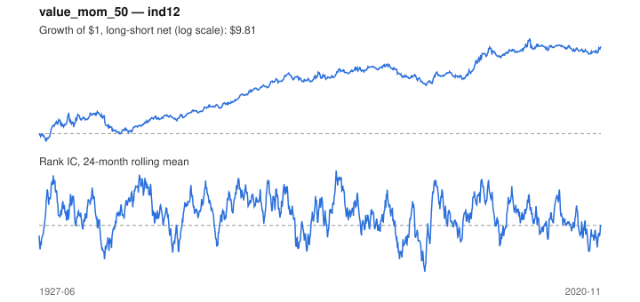

# Signal card: `value_mom_50`

50% value / 50% momentum z-score blend. Universe: `ind12`, 1927-06 to 2020-11 (1122 months), net of 10 bp per unit of turnover.

Verdict: **Not promoted** — passes 4 of 6 gates; fails dsr, pbo.

## Why it should work

Value and momentum are negatively correlated, so a blend has a better risk-adjusted return than either alone.

Reference: Asness, Moskowitz & Pedersen (2013), value and momentum everywhere

## Data and timing

- Momentum uses returns through month t; BE/ME follows the Fama-French June rule.
- Source: Ken French data library (industry portfolios, factors), latest vintage.
- Parameters: `{'weight_value': 0.5}`

## Results

| Metric | Value |
|---|---|
| Mean rank IC | 0.045 |
| IC t-stat (Newey-West) | 3.95 |
| IC information ratio (annual) | 0.43 |
| IC hit rate | 55% |
| Long-short return, annual, net | 2.9% |
| Long-short volatility, annual | 9.9% |
| Sharpe, gross / net | 0.37 / 0.30 |
| Sharpe since 2000, net | 0.26 |
| Probabilistic Sharpe (vs 0) | 1.00 |
| Deflated Sharpe (57 trials) | 0.00 |
| Turnover per month | 0.56 |
| Break-even cost | 54 bp |
| Quintile monotonicity | 1.00 |

IC decay (signal at t vs return k months later): 1m +0.045, 2m +0.039, 3m +0.033, 6m +0.019, 12m -0.024

Annual return by quantile: Q1 +10.2%, Q2 +11.8%, Q3 +13.8%

## Promotion gates (PRD §8.4)

| Gate | Threshold | Value | Result |
|---|---|---|---|
| IC t-stat | ≥ 2 | 3.95 | pass |
| Deflated Sharpe | ≥ 0.95 | 0.00 | fail |
| Family PBO | < 20% | 65% | fail |
| Regimes with IC > 0 | ≥ 3 of 4 | 4 of 4 | pass |
| Ensemble ICIR contribution | > 0 | +0.034 | pass |
| Economic rationale | reference | yes | pass |

IC by market regime: down_calm +0.063, down_volatile +0.002, up_calm +0.030, up_volatile +0.043

## Every configuration tried (`value_momentum` family)

PBO across 3 configurations: 65% over 1122 common months.

| Configuration | IC | t-stat | Sharpe net | DSR |
|---|---|---|---|---|
| `value_mom_25` | 0.066 | 5.77 | 0.32 | 0.01 |
| `value_mom_50` | 0.045 | 3.95 | 0.30 | 0.00 |
| `value_mom_75` | 0.015 | 1.26 | 0.13 | 0.00 |

## Tearsheet



## Where it breaks

- Worst drawdown: -44%, from Feb 1937 to Dec 1940.
- Worst 12 months: -25%, ending Apr 1939.
- Since 2000 the net Sharpe is 0.26 versus 0.30 over the full sample.

## Reproduce

```bash
uv run atlas ingest kenfrench --all
uv run atlas research gates --universe ind12 --exclude-holdout
uv run atlas research signal value_mom_50 --universe ind12
```

_Generated by `atlas research cards` on 2026-10-21. Do not edit by hand._
