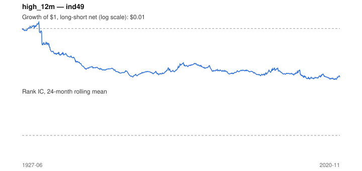

# Signal card: `high_12m`

Distance (log) below the 12-month high of the return index. Universe: `ind49`, 1927-06 to 2020-11 (1121 months), net of 10 bp per unit of turnover.

Verdict: **Not promoted** — passes 5 of 6 gates; fails dsr.

## Why it should work

No rationale recorded.

Reference: George & Hwang (2004), the 52-week high and momentum investing

## Data and timing

- Uses returns through the end of month t; the forecast is month t+1's return.
- Source: Ken French data library (industry portfolios, factors), latest vintage.
- Parameters: `{'months': 12}`

## Results

| Metric | Value |
|---|---|
| Mean rank IC | 0.056 |
| IC t-stat (Newey-West) | 6.67 |
| IC information ratio (annual) | 0.71 |
| IC hit rate | 61% |
| Long-short return, annual, net | -3.2% |
| Long-short volatility, annual | 19.5% |
| Sharpe, gross / net | -0.09 / -0.16 |
| Sharpe since 2000, net | -0.06 |
| Probabilistic Sharpe (vs 0) | 0.05 |
| Deflated Sharpe (57 trials) | 0.00 |
| Turnover per month | 1.19 |
| Break-even cost | -12 bp |
| Quintile monotonicity | 0.90 |

IC decay (signal at t vs return k months later): 1m +nan, 2m +nan, 3m +nan, 6m +nan, 12m +nan

Annual return by quantile: Q1 +9.6%, Q2 +11.6%, Q3 +11.9%, Q4 +12.4%, Q5 +12.0%

## Promotion gates (PRD §8.4)

| Gate | Threshold | Value | Result |
|---|---|---|---|
| IC t-stat | ≥ 2 | 6.67 | pass |
| Deflated Sharpe | ≥ 0.95 | 0.00 | fail |
| Family PBO | < 20% | 7% | pass |
| Regimes with IC > 0 | ≥ 3 of 4 | 4 of 4 | pass |
| Ensemble ICIR contribution | > 0 | +0.038 | pass |
| Economic rationale | reference | yes | pass |

IC by market regime: down_calm +0.097, down_volatile +0.029, up_calm +0.069, up_volatile +0.058

## Every configuration tried (`near_high` family)

PBO across 2 configurations: 7% over 1109 common months.

| Configuration | IC | t-stat | Sharpe net | DSR |
|---|---|---|---|---|
| `high_24m` | 0.060 | 6.98 | -0.09 | 0.00 |
| `high_12m` | 0.056 | 6.67 | -0.16 | 0.00 |

## Tearsheet



## Where it breaks

- Worst drawdown: -100%, from May 1932 to May 2019.
- Worst 12 months: -91%, ending May 1933.
- Since 2000 the net Sharpe is -0.06 versus -0.16 over the full sample.

## Reproduce

```bash
uv run atlas ingest kenfrench --all
uv run atlas research gates --universe ind49 --exclude-holdout
uv run atlas research signal high_12m --universe ind49
```

_Generated by `atlas research cards` on 2026-10-21. Do not edit by hand._
