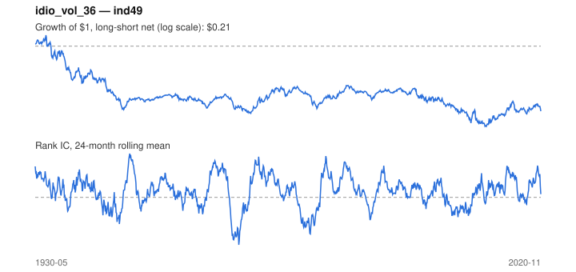

# Signal card: `idio_vol_36`

Negative 36-month residual volatility vs the universe average. Universe: `ind49`, 1930-05 to 2020-11 (1087 months), net of 10 bp per unit of turnover.

Verdict: **Not promoted** — passes 3 of 6 gates; fails dsr, pbo, marginal.

## Why it should work

No rationale recorded.

Reference: Ang, Hodrick, Xing & Zhang (2006), the cross-section of volatility

## Data and timing

- Uses returns through the end of month t; the forecast is month t+1's return.
- Source: Ken French data library (industry portfolios, factors), latest vintage.
- Parameters: `{'window': 36}`

## Results

| Metric | Value |
|---|---|
| Mean rank IC | 0.018 |
| IC t-stat (Newey-West) | 2.80 |
| IC information ratio (annual) | 0.32 |
| IC hit rate | 54% |
| Long-short return, annual, net | -1.1% |
| Long-short volatility, annual | 11.3% |
| Sharpe, gross / net | -0.07 / -0.10 |
| Sharpe since 2000, net | -0.06 |
| Probabilistic Sharpe (vs 0) | 0.18 |
| Deflated Sharpe (57 trials) | 0.00 |
| Turnover per month | 0.22 |
| Break-even cost | -31 bp |
| Quintile monotonicity | -0.70 |

IC decay (signal at t vs return k months later): 1m +0.018, 2m +0.017, 3m +0.017, 6m +0.016, 12m +0.016

Annual return by quantile: Q1 +13.1%, Q2 +12.5%, Q3 +12.0%, Q4 +11.8%, Q5 +12.3%

## Promotion gates (PRD §8.4)

| Gate | Threshold | Value | Result |
|---|---|---|---|
| IC t-stat | ≥ 2 | 2.80 | pass |
| Deflated Sharpe | ≥ 0.95 | 0.00 | fail |
| Family PBO | < 20% | 86% | fail |
| Regimes with IC > 0 | ≥ 3 of 4 | 4 of 4 | pass |
| Ensemble ICIR contribution | > 0 | -0.009 | fail |
| Economic rationale | reference | yes | pass |

IC by market regime: down_calm +0.002, down_volatile +0.041, up_calm +0.024, up_volatile +0.005

## Every configuration tried (`idiosyncratic_vol` family)

PBO across 3 configurations: 86% over 1055 common months.

| Configuration | IC | t-stat | Sharpe net | DSR |
|---|---|---|---|---|
| `idio_vol_24` | 0.015 | 2.34 | -0.07 | 0.00 |
| `idio_vol_36` | 0.018 | 2.80 | -0.10 | 0.00 |
| `idio_vol_60` | 0.014 | 2.11 | -0.13 | 0.00 |

## Tearsheet



## Where it breaks

- Worst drawdown: -89%, from Apr 1932 to Feb 2011.
- Worst 12 months: -39%, ending Apr 1933.
- Since 2000 the net Sharpe is -0.06 versus -0.10 over the full sample.

## Reproduce

```bash
uv run atlas ingest kenfrench --all
uv run atlas research gates --universe ind49 --exclude-holdout
uv run atlas research signal idio_vol_36 --universe ind49
```

_Generated by `atlas research cards` on 2026-10-21. Do not edit by hand._
