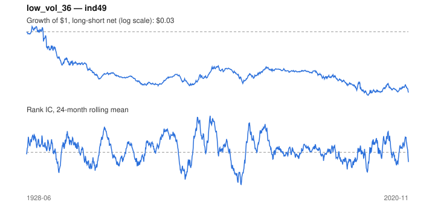

# Signal card: `low_vol_36`

Negative trailing 36-month volatility. Universe: `ind49`, 1928-06 to 2020-11 (1110 months), net of 10 bp per unit of turnover.

Verdict: **Not promoted** — passes 1 of 6 gates; fails ic_tstat, dsr, pbo, regimes, marginal.

## Why it should work

Leverage-constrained investors bid up high-beta, high-volatility assets, leaving low-volatility assets with higher risk-adjusted returns.

Reference: Ang, Hodrick, Xing & Zhang (2006); Frazzini & Pedersen (2014)

## Data and timing

- Uses returns through the end of month t; the forecast is month t+1's return.
- Source: Ken French data library (industry portfolios, factors), latest vintage.
- Parameters: `{'window': 36}`

## Results

| Metric | Value |
|---|---|
| Mean rank IC | 0.017 |
| IC t-stat (Newey-West) | 1.68 |
| IC information ratio (annual) | 0.20 |
| IC hit rate | 52% |
| Long-short return, annual, net | -2.4% |
| Long-short volatility, annual | 16.9% |
| Sharpe, gross / net | -0.13 / -0.14 |
| Sharpe since 2000, net | -0.17 |
| Probabilistic Sharpe (vs 0) | 0.08 |
| Deflated Sharpe (57 trials) | 0.00 |
| Turnover per month | 0.22 |
| Break-even cost | -80 bp |
| Quintile monotonicity | -0.90 |

IC decay (signal at t vs return k months later): 1m +0.017, 2m +0.015, 3m +0.015, 6m +0.016, 12m +0.018

Annual return by quantile: Q1 +13.3%, Q2 +12.8%, Q3 +11.9%, Q4 +12.5%, Q5 +11.2%

## Promotion gates (PRD §8.4)

| Gate | Threshold | Value | Result |
|---|---|---|---|
| IC t-stat | ≥ 2 | 1.68 | fail |
| Deflated Sharpe | ≥ 0.95 | 0.00 | fail |
| Family PBO | < 20% | 50% | fail |
| Regimes with IC > 0 | ≥ 3 of 4 | 2 of 4 | fail |
| Ensemble ICIR contribution | > 0 | -0.038 | fail |
| Economic rationale | reference | yes | pass |

IC by market regime: down_calm -0.001, down_volatile +0.040, up_calm +0.038, up_volatile -0.016

## Every configuration tried (`low_volatility` family)

PBO across 4 configurations: 50% over 1094 common months.

| Configuration | IC | t-stat | Sharpe net | DSR |
|---|---|---|---|---|
| `low_vol_60` | 0.016 | 1.51 | -0.13 | 0.00 |
| `low_vol_36` | 0.017 | 1.68 | -0.14 | 0.00 |
| `low_vol_12` | 0.011 | 1.15 | -0.17 | 0.00 |
| `low_vol_24` | 0.012 | 1.23 | -0.18 | 0.00 |

## Tearsheet



## Where it breaks

- Worst drawdown: -98%, from Oct 1930 to Feb 2011.
- Worst 12 months: -69%, ending Apr 1933.
- Since 2000 the net Sharpe is -0.17 versus -0.14 over the full sample.

## Reproduce

```bash
uv run atlas ingest kenfrench --all
uv run atlas research gates --universe ind49 --exclude-holdout
uv run atlas research signal low_vol_36 --universe ind49
```

_Generated by `atlas research cards` on 2026-10-21. Do not edit by hand._
