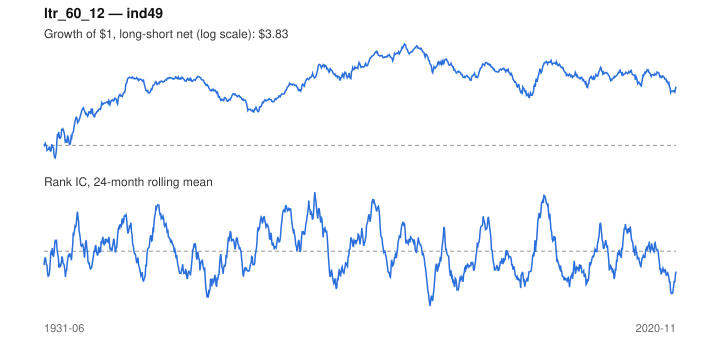

# Signal card: `ltr_60_12`

Negative 60-month return skipping the last 12 months. Universe: `ind49`, 1931-06 to 2020-11 (1074 months), net of 10 bp per unit of turnover.

Verdict: **Not promoted** — passes 1 of 6 gates; fails ic_tstat, dsr, pbo, regimes, marginal.

## Why it should work

Investors over-extrapolate multi-year performance; long-run losers become too cheap and mean-revert.

Reference: De Bondt & Thaler (1985)

## Data and timing

- Uses returns through the end of month t; the forecast is month t+1's return.
- Source: Ken French data library (industry portfolios, factors), latest vintage.
- Parameters: `{'lookback': 60, 'skip': 12}`

## Results

| Metric | Value |
|---|---|
| Mean rank IC | 0.001 |
| IC t-stat (Newey-West) | 0.09 |
| IC information ratio (annual) | 0.01 |
| IC hit rate | 48% |
| Long-short return, annual, net | 2.3% |
| Long-short volatility, annual | 13.1% |
| Sharpe, gross / net | 0.22 / 0.18 |
| Sharpe since 2000, net | 0.13 |
| Probabilistic Sharpe (vs 0) | 0.96 |
| Deflated Sharpe (57 trials) | 0.00 |
| Turnover per month | 0.44 |
| Break-even cost | 54 bp |
| Quintile monotonicity | 0.90 |

IC decay (signal at t vs return k months later): 1m +0.001, 2m +0.003, 3m +0.004, 6m +0.007, 12m +0.009

Annual return by quantile: Q1 +11.5%, Q2 +12.9%, Q3 +12.7%, Q4 +13.7%, Q5 +14.3%

## Promotion gates (PRD §8.4)

| Gate | Threshold | Value | Result |
|---|---|---|---|
| IC t-stat | ≥ 2 | 0.09 | fail |
| Deflated Sharpe | ≥ 0.95 | 0.00 | fail |
| Family PBO | < 20% | 38% | fail |
| Regimes with IC > 0 | ≥ 3 of 4 | 2 of 4 | fail |
| Ensemble ICIR contribution | > 0 | -0.026 | fail |
| Economic rationale | reference | yes | pass |

IC by market regime: down_calm +0.020, down_volatile +0.053, up_calm -0.036, up_volatile -0.009

## Every configuration tried (`long_term_reversal` family)

PBO across 3 configurations: 38% over 1074 common months.

| Configuration | IC | t-stat | Sharpe net | DSR |
|---|---|---|---|---|
| `ltr_60_12` | 0.001 | 0.09 | 0.18 | 0.00 |
| `ltr_36_12` | -0.003 | -0.36 | 0.11 | 0.00 |
| `ltr_60_0` | -0.023 | -2.67 | -0.07 | 0.00 |

## Tearsheet



## Where it breaks

- Worst drawdown: -71%, from Jun 1982 to Feb 2000.
- Worst 12 months: -34%, ending Jun 1986.
- Since 2000 the net Sharpe is 0.13 versus 0.18 over the full sample.

## Reproduce

```bash
uv run atlas ingest kenfrench --all
uv run atlas research gates --universe ind49 --exclude-holdout
uv run atlas research signal ltr_60_12 --universe ind49
```

_Generated by `atlas research cards` on 2026-10-21. Do not edit by hand._
