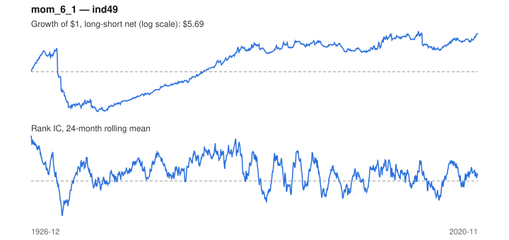

# Signal card: `mom_6_1`

6-month momentum skipping the last 1 month(s). Universe: `ind49`, 1926-12 to 2020-11 (1128 months), net of 10 bp per unit of turnover.

Verdict: **Not promoted** — passes 5 of 6 gates; fails dsr.

## Why it should work

Investors under-react to industry news, so prices drift in the direction of recent performance; Moskowitz & Grinblatt find industry momentum explains much of stock-level momentum.

Reference: Jegadeesh & Titman (1993); Moskowitz & Grinblatt (1999), industry momentum

## Data and timing

- Uses returns through the end of month t; the forecast is month t+1's return.
- Source: Ken French data library (industry portfolios, factors), latest vintage.
- Parameters: `{'lookback': 6, 'skip': 1}`

## Results

| Metric | Value |
|---|---|
| Mean rank IC | 0.043 |
| IC t-stat (Newey-West) | 5.21 |
| IC information ratio (annual) | 0.57 |
| IC hit rate | 57% |
| Long-short return, annual, net | 3.4% |
| Long-short volatility, annual | 16.6% |
| Sharpe, gross / net | 0.30 / 0.21 |
| Sharpe since 2000, net | 0.23 |
| Probabilistic Sharpe (vs 0) | 0.97 |
| Deflated Sharpe (57 trials) | 0.00 |
| Turnover per month | 1.34 |
| Break-even cost | 31 bp |
| Quintile monotonicity | 0.90 |

IC decay (signal at t vs return k months later): 1m +0.043, 2m +0.046, 3m +0.042, 6m +0.047, 12m -0.004

Annual return by quantile: Q1 +10.2%, Q2 +12.2%, Q3 +12.8%, Q4 +12.7%, Q5 +15.2%

## Promotion gates (PRD §8.4)

| Gate | Threshold | Value | Result |
|---|---|---|---|
| IC t-stat | ≥ 2 | 5.21 | pass |
| Deflated Sharpe | ≥ 0.95 | 0.00 | fail |
| Family PBO | < 20% | 4% | pass |
| Regimes with IC > 0 | ≥ 3 of 4 | 4 of 4 | pass |
| Ensemble ICIR contribution | > 0 | +0.045 | pass |
| Economic rationale | reference | yes | pass |

IC by market regime: down_calm +0.082, down_volatile +0.019, up_calm +0.030, up_volatile +0.033

## Every configuration tried (`momentum` family)

PBO across 12 configurations: 4% over 1110 common months.

| Configuration | IC | t-stat | Sharpe net | DSR |
|---|---|---|---|---|
| `mom_12_0` | 0.074 | 8.80 | 0.46 | 0.05 |
| `mom_12_1` | 0.070 | 8.58 | 0.43 | 0.03 |
| `mom_9_0` | 0.059 | 7.40 | 0.39 | 0.01 |
| `mom_18_1` | 0.050 | 6.00 | 0.30 | 0.00 |
| `mom_18_0` | 0.052 | 6.12 | 0.30 | 0.00 |
| `mom_9_1` | 0.054 | 7.03 | 0.29 | 0.00 |
| `mom_6_0` | 0.053 | 6.22 | 0.27 | 0.00 |
| `mom_24_0` | 0.045 | 5.40 | 0.22 | 0.00 |
| `mom_6_1` | 0.043 | 5.21 | 0.21 | 0.00 |
| `mom_24_1` | 0.043 | 5.29 | 0.19 | 0.00 |
| `mom_3_0` | 0.041 | 4.98 | 0.17 | 0.00 |
| `mom_3_1` | 0.027 | 3.58 | -0.00 | 0.00 |

## Tearsheet



## Where it breaks

- Worst drawdown: -94%, from Apr 1932 to Jan 1941.
- Worst 12 months: -85%, ending Apr 1933.
- Since 2000 the net Sharpe is 0.23 versus 0.21 over the full sample.

## Reproduce

```bash
uv run atlas ingest kenfrench --all
uv run atlas research gates --universe ind49 --exclude-holdout
uv run atlas research signal mom_6_1 --universe ind49
```

_Generated by `atlas research cards` on 2026-10-21. Do not edit by hand._
