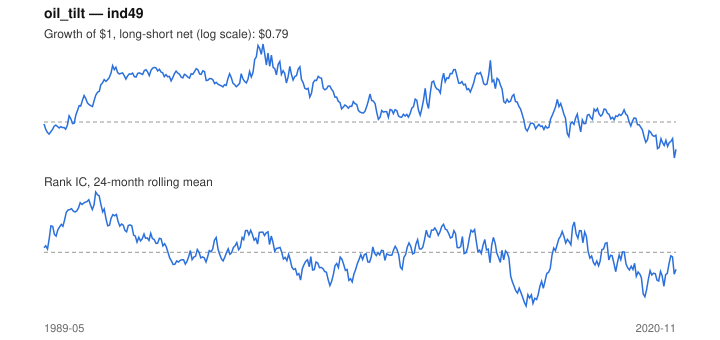

# Signal card: `oil_tilt`

Sensitivity to oil (60-month beta) times its 3-month move. Universe: `ind49`, 1989-05 to 2020-11 (379 months), net of 10 bp per unit of turnover.

Verdict: **Not promoted** — passes 2 of 6 gates; fails ic_tstat, dsr, pbo, marginal.

## Why it should work

No rationale recorded.

Reference: PRD §6.4 macro-to-sector sensitivity; Moskowitz, Ooi & Pedersen (2012) on trend persistence

## Data and timing

- Uses returns through the end of month t; the forecast is month t+1's return.
- Source: Ken French data library (industry portfolios, factors), latest vintage.
- Parameters: `{'window': 60, 'trend': 3}`

## Results

| Metric | Value |
|---|---|
| Mean rank IC | 0.004 |
| IC t-stat (Newey-West) | 0.30 |
| IC information ratio (annual) | 0.05 |
| IC hit rate | 53% |
| Long-short return, annual, net | 0.5% |
| Long-short volatility, annual | 15.8% |
| Sharpe, gross / net | 0.12 / 0.03 |
| Sharpe since 2000, net | -0.13 |
| Probabilistic Sharpe (vs 0) | 0.57 |
| Deflated Sharpe (57 trials) | 0.00 |
| Turnover per month | 1.17 |
| Break-even cost | 14 bp |
| Quintile monotonicity | 0.40 |

IC decay (signal at t vs return k months later): 1m +0.004, 2m +0.003, 3m -0.021, 6m -0.008, 12m -0.016

Annual return by quantile: Q1 +9.8%, Q2 +11.8%, Q3 +12.5%, Q4 +12.8%, Q5 +11.7%

## Promotion gates (PRD §8.4)

| Gate | Threshold | Value | Result |
|---|---|---|---|
| IC t-stat | ≥ 2 | 0.30 | fail |
| Deflated Sharpe | ≥ 0.95 | 0.00 | fail |
| Family PBO | < 20% | 73% | fail |
| Regimes with IC > 0 | ≥ 3 of 4 | 3 of 4 | pass |
| Ensemble ICIR contribution | > 0 | -0.008 | fail |
| Economic rationale | reference | yes | pass |

IC by market regime: down_calm +0.031, down_volatile -0.026, up_calm +0.011, up_volatile +0.007

## Every configuration tried (`oil_tilt` family)

PBO across 4 configurations: 73% over 379 common months.

| Configuration | IC | t-stat | Sharpe net | DSR |
|---|---|---|---|---|
| `oil_tilt_36_3` | 0.002 | 0.17 | 0.03 | 0.00 |
| `oil_tilt` | 0.004 | 0.30 | 0.03 | 0.00 |
| `oil_tilt_36_1` | 0.002 | 0.16 | -0.03 | 0.00 |
| `oil_tilt_60_1` | 0.004 | 0.29 | -0.09 | 0.00 |

## Tearsheet



## Where it breaks

- Worst drawdown: -62%, from Apr 2000 to Oct 2020.
- Worst 12 months: -30%, ending Aug 2012.
- Since 2000 the net Sharpe is -0.13 versus 0.03 over the full sample.

## Reproduce

```bash
uv run atlas ingest kenfrench --all
uv run atlas research gates --universe ind49 --exclude-holdout
uv run atlas research signal oil_tilt --universe ind49
```

_Generated by `atlas research cards` on 2026-10-21. Do not edit by hand._
