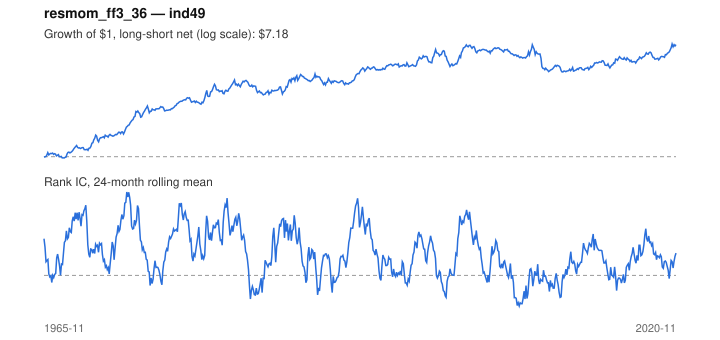

# Signal card: `resmom_ff3_36`

12-1 momentum of residual returns after FF3 exposure (36-month rolling regression). Universe: `ind49`, 1965-11 to 2020-11 (661 months), net of 10 bp per unit of turnover.

Verdict: **Not promoted** — passes 4 of 6 gates; fails dsr, pbo.

## Why it should work

Raw momentum loads on whatever factors did well recently and crashes when they reverse. Ranking on returns after removing factor exposure keeps the under-reaction signal and drops most of the crash risk.

Reference: Blitz, Huij & Martens (2011), residual momentum

## Data and timing

- Factor betas are estimated on the trailing window ending at month t; only returns through t enter.
- Source: Ken French data library (industry portfolios, factors), latest vintage.
- Parameters: `{'window': 36, 'factors_ff3': 1}`

## Results

| Metric | Value |
|---|---|
| Mean rank IC | 0.036 |
| IC t-stat (Newey-West) | 4.32 |
| IC information ratio (annual) | 0.60 |
| IC hit rate | 57% |
| Long-short return, annual, net | 4.1% |
| Long-short volatility, annual | 9.9% |
| Sharpe, gross / net | 0.57 / 0.41 |
| Sharpe since 2000, net | 0.09 |
| Probabilistic Sharpe (vs 0) | 1.00 |
| Deflated Sharpe (57 trials) | 0.03 |
| Turnover per month | 1.29 |
| Break-even cost | 36 bp |
| Quintile monotonicity | 1.00 |

IC decay (signal at t vs return k months later): 1m +0.036, 2m +0.042, 3m +0.036, 6m +0.012, 12m -0.012

Annual return by quantile: Q1 +8.9%, Q2 +11.9%, Q3 +12.3%, Q4 +12.6%, Q5 +14.5%

## Promotion gates (PRD §8.4)

| Gate | Threshold | Value | Result |
|---|---|---|---|
| IC t-stat | ≥ 2 | 4.32 | pass |
| Deflated Sharpe | ≥ 0.95 | 0.03 | fail |
| Family PBO | < 20% | 36% | fail |
| Regimes with IC > 0 | ≥ 3 of 4 | 4 of 4 | pass |
| Ensemble ICIR contribution | > 0 | +0.030 | pass |
| Economic rationale | reference | yes | pass |

IC by market regime: down_calm +0.071, down_volatile +0.023, up_calm +0.035, up_volatile +0.041

## Every configuration tried (`residual_momentum` family)

PBO across 4 configurations: 36% over 642 common months.

| Configuration | IC | t-stat | Sharpe net | DSR |
|---|---|---|---|---|
| `resmom_ff3_60` | 0.040 | 4.39 | 0.51 | 0.13 |
| `resmom_ff5_36` | 0.039 | 4.82 | 0.46 | 0.07 |
| `resmom_ff3_36` | 0.036 | 4.32 | 0.41 | 0.03 |
| `resmom_ff5_60` | 0.043 | 4.87 | 0.39 | 0.03 |

## Tearsheet



## Where it breaks

- Worst drawdown: -38%, from May 2008 to Dec 2010.
- Worst 12 months: -34%, ending May 2009.
- Since 2000 the net Sharpe is 0.09 versus 0.41 over the full sample.

## Reproduce

```bash
uv run atlas ingest kenfrench --all
uv run atlas research gates --universe ind49 --exclude-holdout
uv run atlas research signal resmom_ff3_36 --universe ind49
```

_Generated by `atlas research cards` on 2026-10-21. Do not edit by hand._
