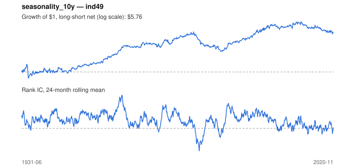

# Signal card: `seasonality_10y`

Average return in the coming calendar month over the past 10 years. Universe: `ind49`, 1931-06 to 2020-11 (1074 months), net of 10 bp per unit of turnover.

Verdict: **Not promoted** — passes 4 of 6 gates; fails dsr, pbo.

## Why it should work

No rationale recorded.

Reference: Heston & Sadka (2008), seasonality in the cross-section of returns

## Data and timing

- Uses returns through the end of month t; the forecast is month t+1's return.
- Source: Ken French data library (industry portfolios, factors), latest vintage.
- Parameters: `{'years': 10}`

## Results

| Metric | Value |
|---|---|
| Mean rank IC | 0.049 |
| IC t-stat (Newey-West) | 7.92 |
| IC information ratio (annual) | 0.83 |
| IC hit rate | 58% |
| Long-short return, annual, net | 2.6% |
| Long-short volatility, annual | 11.1% |
| Sharpe, gross / net | 0.56 / 0.23 |
| Sharpe since 2000, net | 0.04 |
| Probabilistic Sharpe (vs 0) | 0.99 |
| Deflated Sharpe (57 trials) | 0.00 |
| Turnover per month | 3.05 |
| Break-even cost | 17 bp |
| Quintile monotonicity | 1.00 |

IC decay (signal at t vs return k months later): 1m +0.049, 2m -0.005, 3m -0.021, 6m -0.016, 12m +0.003

Annual return by quantile: Q1 +10.1%, Q2 +11.9%, Q3 +12.6%, Q4 +14.3%, Q5 +16.4%

## Promotion gates (PRD §8.4)

| Gate | Threshold | Value | Result |
|---|---|---|---|
| IC t-stat | ≥ 2 | 7.92 | pass |
| Deflated Sharpe | ≥ 0.95 | 0.00 | fail |
| Family PBO | < 20% | 55% | fail |
| Regimes with IC > 0 | ≥ 3 of 4 | 4 of 4 | pass |
| Ensemble ICIR contribution | > 0 | +0.102 | pass |
| Economic rationale | reference | yes | pass |

IC by market regime: down_calm +0.053, down_volatile +0.016, up_calm +0.031, up_volatile +0.053

## Every configuration tried (`seasonality` family)

PBO across 3 configurations: 55% over 1014 common months.

| Configuration | IC | t-stat | Sharpe net | DSR |
|---|---|---|---|---|
| `seasonality_10y` | 0.049 | 7.92 | 0.23 | 0.00 |
| `seasonality_20y` | 0.046 | 7.13 | 0.17 | 0.00 |
| `seasonality_5y` | 0.043 | 6.29 | 0.13 | 0.00 |

## Tearsheet



## Where it breaks

- Worst drawdown: -58%, from Oct 1980 to Aug 1988.
- Worst 12 months: -37%, ending Nov 1933.
- Since 2000 the net Sharpe is 0.04 versus 0.23 over the full sample.

## Reproduce

```bash
uv run atlas ingest kenfrench --all
uv run atlas research gates --universe ind49 --exclude-holdout
uv run atlas research signal seasonality_10y --universe ind49
```

_Generated by `atlas research cards` on 2026-10-21. Do not edit by hand._
