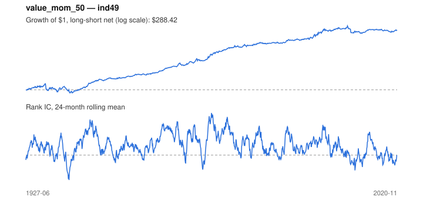

# Signal card: `value_mom_50`

50% value / 50% momentum z-score blend. Universe: `ind49`, 1927-06 to 2020-11 (1122 months), net of 10 bp per unit of turnover.

Verdict: **Not promoted** — passes 4 of 6 gates; fails dsr, pbo.

## Why it should work

Value and momentum are negatively correlated, so a blend has a better risk-adjusted return than either alone.

Reference: Asness, Moskowitz & Pedersen (2013), value and momentum everywhere

## Data and timing

- Momentum uses returns through month t; BE/ME follows the Fama-French June rule.
- Source: Ken French data library (industry portfolios, factors), latest vintage.
- Parameters: `{'weight_value': 0.5}`

## Results

| Metric | Value |
|---|---|
| Mean rank IC | 0.048 |
| IC t-stat (Newey-West) | 6.15 |
| IC information ratio (annual) | 0.70 |
| IC hit rate | 60% |
| Long-short return, annual, net | 7.0% |
| Long-short volatility, annual | 13.1% |
| Sharpe, gross / net | 0.59 / 0.53 |
| Sharpe since 2000, net | 0.25 |
| Probabilistic Sharpe (vs 0) | 1.00 |
| Deflated Sharpe (57 trials) | 0.12 |
| Turnover per month | 0.67 |
| Break-even cost | 97 bp |
| Quintile monotonicity | 1.00 |

IC decay (signal at t vs return k months later): 1m +0.048, 2m +0.045, 3m +0.036, 6m +0.028, 12m -0.009

Annual return by quantile: Q1 +9.0%, Q2 +10.8%, Q3 +13.2%, Q4 +13.7%, Q5 +16.7%

## Promotion gates (PRD §8.4)

| Gate | Threshold | Value | Result |
|---|---|---|---|
| IC t-stat | ≥ 2 | 6.15 | pass |
| Deflated Sharpe | ≥ 0.95 | 0.12 | fail |
| Family PBO | < 20% | 96% | fail |
| Regimes with IC > 0 | ≥ 3 of 4 | 4 of 4 | pass |
| Ensemble ICIR contribution | > 0 | +0.061 | pass |
| Economic rationale | reference | yes | pass |

IC by market regime: down_calm +0.104, down_volatile +0.055, up_calm +0.032, up_volatile +0.048

## Every configuration tried (`value_momentum` family)

PBO across 3 configurations: 96% over 1122 common months.

| Configuration | IC | t-stat | Sharpe net | DSR |
|---|---|---|---|---|
| `value_mom_50` | 0.048 | 6.15 | 0.53 | 0.12 |
| `value_mom_25` | 0.066 | 8.07 | 0.52 | 0.11 |
| `value_mom_75` | 0.022 | 2.74 | 0.40 | 0.00 |

## Tearsheet



## Where it breaks

- Worst drawdown: -58%, from Apr 1932 to Jul 1938.
- Worst 12 months: -47%, ending May 2009.
- Since 2000 the net Sharpe is 0.25 versus 0.53 over the full sample.

## Reproduce

```bash
uv run atlas ingest kenfrench --all
uv run atlas research gates --universe ind49 --exclude-holdout
uv run atlas research signal value_mom_50 --universe ind49
```

_Generated by `atlas research cards` on 2026-10-21. Do not edit by hand._
