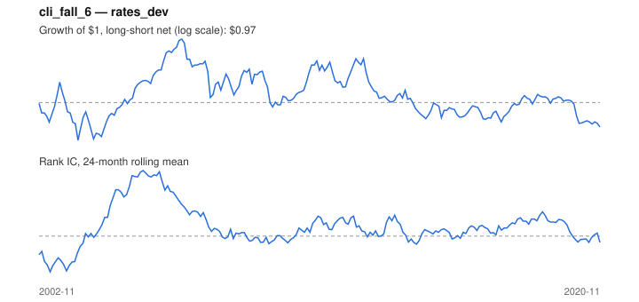

# Signal card: `cli_fall_6`

Fall in the OECD leading indicator over 6 months (bonds rally). Universe: `rates_dev`, 2002-11 to 2020-11 (216 months), net of 10 bp per unit of turnover.

Verdict: **Not promoted** — passes 1 of 6 gates; fails ic_tstat, dsr, pbo, regimes, marginal.

## Why it should work

No rationale recorded.

Reference: Ilmanen (2003); bond returns and the business cycle

## Data and timing

- Uses returns through the end of month t; the forecast is month t+1's return.
- Source: Ken French data library (industry portfolios, factors), latest vintage.
- Parameters: `{'months': 6}`

## Results

| Metric | Value |
|---|---|
| Mean rank IC | 0.054 |
| IC t-stat (Newey-West) | 1.61 |
| IC information ratio (annual) | 0.43 |
| IC hit rate | 58% |
| Long-short return, annual, net | -0.1% |
| Long-short volatility, annual | 2.5% |
| Sharpe, gross / net | 0.21 / -0.05 |
| Sharpe since 2000, net | -0.05 |
| Probabilistic Sharpe (vs 0) | 0.41 |
| Deflated Sharpe (16 trials) | 0.00 |
| Turnover per month | 0.53 |
| Break-even cost | 8 bp |
| Quintile monotonicity | 0.50 |

IC decay (signal at t vs return k months later): 1m +0.054, 2m +0.030, 3m +0.032, 6m +0.024, 12m +0.016

Annual return by quantile: Q1 +2.2%, Q2 +2.8%, Q3 +2.7%

## Promotion gates (PRD §8.4)

| Gate | Threshold | Value | Result |
|---|---|---|---|
| IC t-stat | ≥ 2 | 1.61 | fail |
| Deflated Sharpe | ≥ 0.95 | 0.00 | fail |
| Family PBO | < 20% | 90% | fail |
| Regimes with IC > 0 | ≥ 3 of 4 | 2 of 4 | fail |
| Ensemble ICIR contribution | > 0 | -0.011 | fail |
| Economic rationale | reference | yes | pass |

IC by market regime: down_calm -0.322, down_volatile +0.007, up_calm +0.117, up_volatile -0.012

## Every configuration tried (`growth` family)

PBO across 3 configurations: 90% over 210 common months.

| Configuration | IC | t-stat | Sharpe net | DSR |
|---|---|---|---|---|
| `cli_fall_3` | 0.094 | 3.10 | 0.10 | 0.01 |
| `cli_fall_12` | 0.037 | 1.04 | 0.07 | 0.01 |
| `cli_fall_6` | 0.054 | 1.61 | -0.05 | 0.00 |

## Tearsheet



## Where it breaks

- Worst drawdown: -10%, from Jun 2007 to Nov 2020.
- Worst 12 months: -7%, ending May 2008.
- Since 2000 the net Sharpe is -0.05 versus -0.05 over the full sample.

## Reproduce

```bash
uv run atlas ingest sdmx --agency oecd
uv run atlas research gates --universe rates_dev --exclude-holdout
uv run atlas research signal cli_fall_6 --universe rates_dev
```

_Generated by `atlas research cards` on 2026-10-21. Do not edit by hand._
