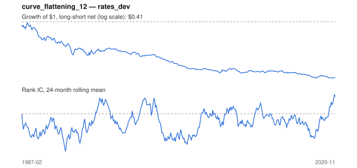

# Signal card: `curve_flattening_12`

Flattening of the 10Y-3M curve over 12 months. Universe: `rates_dev`, 1987-02 to 2020-11 (406 months), net of 10 bp per unit of turnover.

Verdict: **Not promoted** — passes 1 of 6 gates; fails ic_tstat, dsr, pbo, regimes, marginal.

## Why it should work

No rationale recorded.

Reference: Cochrane & Piazzesi (2005) on the term structure of bond risk premia

## Data and timing

- Uses returns through the end of month t; the forecast is month t+1's return.
- Source: Ken French data library (industry portfolios, factors), latest vintage.
- Parameters: `{'months': 12}`

## Results

| Metric | Value |
|---|---|
| Mean rank IC | -0.060 |
| IC t-stat (Newey-West) | -2.60 |
| IC information ratio (annual) | -0.50 |
| IC hit rate | 44% |
| Long-short return, annual, net | -2.5% |
| Long-short volatility, annual | 4.5% |
| Sharpe, gross / net | -0.36 / -0.56 |
| Sharpe since 2000, net | -0.64 |
| Probabilistic Sharpe (vs 0) | 0.00 |
| Deflated Sharpe (16 trials) | 0.00 |
| Turnover per month | 0.74 |
| Break-even cost | -19 bp |
| Quintile monotonicity | -1.00 |

IC decay (signal at t vs return k months later): 1m -0.060, 2m -0.054, 3m -0.041, 6m -0.025, 12m -0.022

Annual return by quantile: Q1 +3.9%, Q2 +2.4%, Q3 +2.2%

## Promotion gates (PRD §8.4)

| Gate | Threshold | Value | Result |
|---|---|---|---|
| IC t-stat | ≥ 2 | -2.60 | fail |
| Deflated Sharpe | ≥ 0.95 | 0.00 | fail |
| Family PBO | < 20% | 51% | fail |
| Regimes with IC > 0 | ≥ 3 of 4 | 0 of 4 | fail |
| Ensemble ICIR contribution | > 0 | -0.016 | fail |
| Economic rationale | reference | yes | pass |

IC by market regime: down_calm -0.114, down_volatile -0.046, up_calm -0.082, up_volatile -0.023

## Every configuration tried (`curve_change` family)

PBO across 2 configurations: 51% over 406 common months.

| Configuration | IC | t-stat | Sharpe net | DSR |
|---|---|---|---|---|
| `curve_flattening_12` | -0.060 | -2.60 | -0.56 | 0.00 |
| `curve_flattening_6` | -0.064 | -2.93 | -0.66 | 0.00 |

## Tearsheet



## Where it breaks

- Worst drawdown: -59%, from Sep 1987 to Oct 2018.
- Worst 12 months: -18%, ending May 1989.
- Since 2000 the net Sharpe is -0.64 versus -0.56 over the full sample.

## Reproduce

```bash
uv run atlas ingest sdmx --agency oecd
uv run atlas research gates --universe rates_dev --exclude-holdout
uv run atlas research signal curve_flattening_12 --universe rates_dev
```

_Generated by `atlas research cards` on 2026-10-21. Do not edit by hand._
