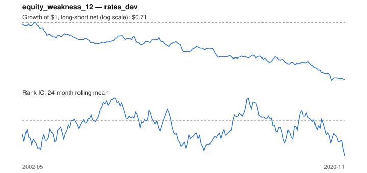

# Signal card: `equity_weakness_12`

Weak local equity market over 12 months (flight to quality). Universe: `rates_dev`, 2002-05 to 2020-11 (222 months), net of 10 bp per unit of turnover.

Verdict: **Not promoted** — passes 1 of 6 gates; fails ic_tstat, dsr, pbo, regimes, marginal.

## Why it should work

No rationale recorded.

Reference: Baele, Bekaert & Inghelbrecht (2010), stock-bond return comovement

## Data and timing

- Uses returns through the end of month t; the forecast is month t+1's return.
- Source: Ken French data library (industry portfolios, factors), latest vintage.
- Parameters: `{'months': 12}`

## Results

| Metric | Value |
|---|---|
| Mean rank IC | -0.038 |
| IC t-stat (Newey-West) | -1.16 |
| IC information ratio (annual) | -0.28 |
| IC hit rate | 44% |
| Long-short return, annual, net | -1.8% |
| Long-short volatility, annual | 2.6% |
| Sharpe, gross / net | -0.38 / -0.69 |
| Sharpe since 2000, net | -0.69 |
| Probabilistic Sharpe (vs 0) | 0.00 |
| Deflated Sharpe (16 trials) | 0.00 |
| Turnover per month | 0.68 |
| Break-even cost | -12 bp |
| Quintile monotonicity | -0.50 |

IC decay (signal at t vs return k months later): 1m -0.038, 2m -0.031, 3m -0.033, 6m -0.032, 12m +0.013

Annual return by quantile: Q1 +3.1%, Q2 +3.3%, Q3 +2.1%

## Promotion gates (PRD §8.4)

| Gate | Threshold | Value | Result |
|---|---|---|---|
| IC t-stat | ≥ 2 | -1.16 | fail |
| Deflated Sharpe | ≥ 0.95 | 0.00 | fail |
| Family PBO | < 20% | n/a | fail |
| Regimes with IC > 0 | ≥ 3 of 4 | 1 of 4 | fail |
| Ensemble ICIR contribution | > 0 | -0.002 | fail |
| Economic rationale | reference | yes | pass |

IC by market regime: down_calm -0.371, down_volatile -0.060, up_calm +0.029, up_volatile -0.132

## Every configuration tried (`flight_to_quality` family)

PBO across 1 configurations: n/a over 0 common months.

| Configuration | IC | t-stat | Sharpe net | DSR |
|---|---|---|---|---|
| `equity_weakness_12` | -0.038 | -1.16 | -0.69 | 0.00 |

## Tearsheet



## Where it breaks

- Worst drawdown: -29%, from Jan 2003 to Feb 2020.
- Worst 12 months: -8%, ending Feb 2004.
- Since 2000 the net Sharpe is -0.69 versus -0.69 over the full sample.

## Reproduce

```bash
uv run atlas ingest sdmx --agency oecd
uv run atlas research gates --universe rates_dev --exclude-holdout
uv run atlas research signal equity_weakness_12 --universe rates_dev
```

_Generated by `atlas research cards` on 2026-10-21. Do not edit by hand._
