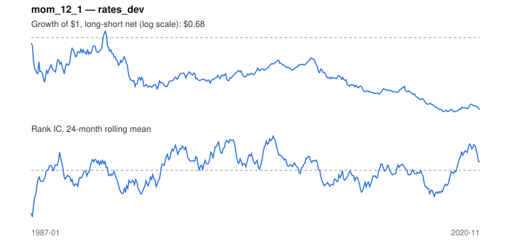

# Signal card: `mom_12_1`

12-month momentum skipping the last 1 month(s). Universe: `rates_dev`, 1987-01 to 2020-11 (407 months), net of 10 bp per unit of turnover.

Verdict: **Not promoted** — passes 3 of 6 gates; fails ic_tstat, dsr, regimes.

## Why it should work

Investors under-react to industry news, so prices drift in the direction of recent performance; Moskowitz & Grinblatt find industry momentum explains much of stock-level momentum.

Reference: Jegadeesh & Titman (1993); Moskowitz & Grinblatt (1999), industry momentum

## Data and timing

- Uses returns through the end of month t; the forecast is month t+1's return.
- Source: Ken French data library (industry portfolios, factors), latest vintage.
- Parameters: `{'lookback': 12, 'skip': 1}`

## Results

| Metric | Value |
|---|---|
| Mean rank IC | 0.006 |
| IC t-stat (Newey-West) | 0.24 |
| IC information ratio (annual) | 0.05 |
| IC hit rate | 50% |
| Long-short return, annual, net | -1.0% |
| Long-short volatility, annual | 4.6% |
| Sharpe, gross / net | -0.03 / -0.23 |
| Sharpe since 2000, net | -0.29 |
| Probabilistic Sharpe (vs 0) | 0.10 |
| Deflated Sharpe (16 trials) | 0.00 |
| Turnover per month | 0.75 |
| Break-even cost | -1 bp |
| Quintile monotonicity | -0.50 |

IC decay (signal at t vs return k months later): 1m +0.006, 2m +0.002, 3m +0.003, 6m +0.011, 12m -0.022

Annual return by quantile: Q1 +3.1%, Q2 +2.7%, Q3 +3.0%

## Promotion gates (PRD §8.4)

| Gate | Threshold | Value | Result |
|---|---|---|---|
| IC t-stat | ≥ 2 | 0.24 | fail |
| Deflated Sharpe | ≥ 0.95 | 0.00 | fail |
| Family PBO | < 20% | 3% | pass |
| Regimes with IC > 0 | ≥ 3 of 4 | 1 of 4 | fail |
| Ensemble ICIR contribution | > 0 | +0.260 | pass |
| Economic rationale | reference | yes | pass |

IC by market regime: down_calm -0.075, down_volatile -0.014, up_calm +0.028, up_volatile -0.007

## Every configuration tried (`momentum` family)

PBO across 3 configurations: 3% over 407 common months.

| Configuration | IC | t-stat | Sharpe net | DSR |
|---|---|---|---|---|
| `mom_12_1` | 0.006 | 0.24 | -0.23 | 0.00 |
| `mom_3_1` | -0.018 | -0.76 | -0.67 | 0.00 |
| `mom_6_1` | -0.032 | -1.21 | -0.77 | 0.00 |

## Tearsheet



## Where it breaks

- Worst drawdown: -35%, from Aug 1992 to Dec 2018.
- Worst 12 months: -19%, ending Dec 1987.
- Since 2000 the net Sharpe is -0.29 versus -0.23 over the full sample.

## Reproduce

```bash
uv run atlas ingest sdmx --agency oecd
uv run atlas research gates --universe rates_dev --exclude-holdout
uv run atlas research signal mom_12_1 --universe rates_dev
```

_Generated by `atlas research cards` on 2026-10-21. Do not edit by hand._
