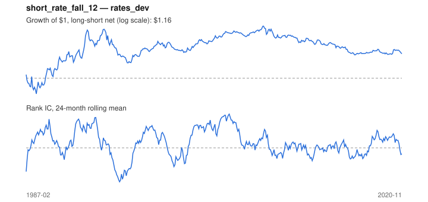

# Signal card: `short_rate_fall_12`

Fall in the 3-month rate over 12 months (easing cycle). Universe: `rates_dev`, 1987-02 to 2020-11 (406 months), net of 10 bp per unit of turnover.

Verdict: **Not promoted** — passes 3 of 6 gates; fails ic_tstat, dsr, pbo.

## Why it should work

No rationale recorded.

Reference: Ilmanen (2011), expected returns; bonds in easing cycles

## Data and timing

- Uses returns through the end of month t; the forecast is month t+1's return.
- Source: Ken French data library (industry portfolios, factors), latest vintage.
- Parameters: `{'months': 12}`

## Results

| Metric | Value |
|---|---|
| Mean rank IC | 0.032 |
| IC t-stat (Newey-West) | 1.37 |
| IC information ratio (annual) | 0.26 |
| IC hit rate | 53% |
| Long-short return, annual, net | 0.5% |
| Long-short volatility, annual | 4.4% |
| Sharpe, gross / net | 0.26 / 0.12 |
| Sharpe since 2000, net | -0.12 |
| Probabilistic Sharpe (vs 0) | 0.76 |
| Deflated Sharpe (16 trials) | 0.00 |
| Turnover per month | 0.52 |
| Break-even cost | 18 bp |
| Quintile monotonicity | 0.50 |

IC decay (signal at t vs return k months later): 1m +0.032, 2m +0.036, 3m +0.027, 6m +0.027, 12m +0.012

Annual return by quantile: Q1 +2.7%, Q2 +2.4%, Q3 +3.9%

## Promotion gates (PRD §8.4)

| Gate | Threshold | Value | Result |
|---|---|---|---|
| IC t-stat | ≥ 2 | 1.37 | fail |
| Deflated Sharpe | ≥ 0.95 | 0.00 | fail |
| Family PBO | < 20% | 70% | fail |
| Regimes with IC > 0 | ≥ 3 of 4 | 4 of 4 | pass |
| Ensemble ICIR contribution | > 0 | +0.226 | pass |
| Economic rationale | reference | yes | pass |

IC by market regime: down_calm +0.006, down_volatile +0.011, up_calm +0.052, up_volatile +0.014

## Every configuration tried (`policy_easing` family)

PBO across 2 configurations: 70% over 406 common months.

| Configuration | IC | t-stat | Sharpe net | DSR |
|---|---|---|---|---|
| `short_rate_fall_12` | 0.032 | 1.37 | 0.12 | 0.00 |
| `short_rate_fall_6` | 0.034 | 1.71 | 0.03 | 0.00 |

## Tearsheet



## Where it breaks

- Worst drawdown: -18%, from Feb 1994 to Apr 1996.
- Worst 12 months: -11%, ending Jun 1995.
- Since 2000 the net Sharpe is -0.12 versus 0.12 over the full sample.

## Reproduce

```bash
uv run atlas ingest sdmx --agency oecd
uv run atlas research gates --universe rates_dev --exclude-holdout
uv run atlas research signal short_rate_fall_12 --universe rates_dev
```

_Generated by `atlas research cards` on 2026-10-21. Do not edit by hand._
