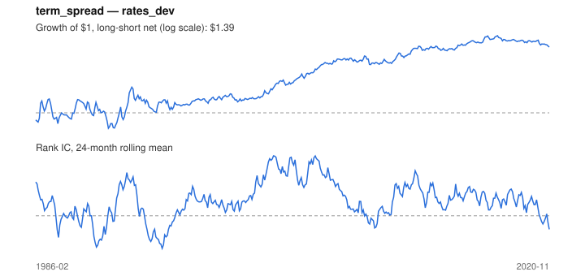

# Signal card: `term_spread`

10-year yield minus the 3-month rate (bond carry). Universe: `rates_dev`, 1986-02 to 2020-11 (418 months), net of 10 bp per unit of turnover.

Verdict: **Not promoted** — passes 4 of 6 gates; fails dsr, pbo.

## Why it should work

No rationale recorded.

Reference: Koijen, Moskowitz, Pedersen & Vrugt (2018); Ilmanen (1995) on bond risk premia

## Data and timing

- Uses returns through the end of month t; the forecast is month t+1's return.
- Source: Ken French data library (industry portfolios, factors), latest vintage.
- Parameters: `{'smooth': 1}`

## Results

| Metric | Value |
|---|---|
| Mean rank IC | 0.065 |
| IC t-stat (Newey-West) | 3.21 |
| IC information ratio (annual) | 0.59 |
| IC hit rate | 55% |
| Long-short return, annual, net | 1.0% |
| Long-short volatility, annual | 4.1% |
| Sharpe, gross / net | 0.36 / 0.25 |
| Sharpe since 2000, net | 0.56 |
| Probabilistic Sharpe (vs 0) | 0.93 |
| Deflated Sharpe (16 trials) | 0.01 |
| Turnover per month | 0.37 |
| Break-even cost | 33 bp |
| Quintile monotonicity | 0.50 |

IC decay (signal at t vs return k months later): 1m +0.065, 2m +0.061, 3m +0.059, 6m +0.045, 12m +0.032

Annual return by quantile: Q1 +2.0%, Q2 +3.6%, Q3 +3.4%

## Promotion gates (PRD §8.4)

| Gate | Threshold | Value | Result |
|---|---|---|---|
| IC t-stat | ≥ 2 | 3.21 | pass |
| Deflated Sharpe | ≥ 0.95 | 0.01 | fail |
| Family PBO | < 20% | 37% | fail |
| Regimes with IC > 0 | ≥ 3 of 4 | 3 of 4 | pass |
| Ensemble ICIR contribution | > 0 | +0.257 | pass |
| Economic rationale | reference | yes | pass |

IC by market regime: down_calm -0.048, down_volatile +0.046, up_calm +0.079, up_volatile +0.068

## Every configuration tried (`carry` family)

PBO across 3 configurations: 37% over 407 common months.

| Configuration | IC | t-stat | Sharpe net | DSR |
|---|---|---|---|---|
| `term_spread` | 0.065 | 3.21 | 0.25 | 0.01 |
| `term_spread_avg_3` | 0.063 | 3.26 | 0.22 | 0.00 |
| `term_spread_avg_12` | 0.048 | 2.48 | 0.02 | 0.00 |

## Tearsheet



## Where it breaks

- Worst drawdown: -14%, from Jan 1987 to Jan 1991.
- Worst 12 months: -10%, ending Mar 1991.
- Since 2000 the net Sharpe is 0.56 versus 0.25 over the full sample.

## Reproduce

```bash
uv run atlas ingest sdmx --agency oecd
uv run atlas research gates --universe rates_dev --exclude-holdout
uv run atlas research signal term_spread --universe rates_dev
```

_Generated by `atlas research cards` on 2026-10-21. Do not edit by hand._
