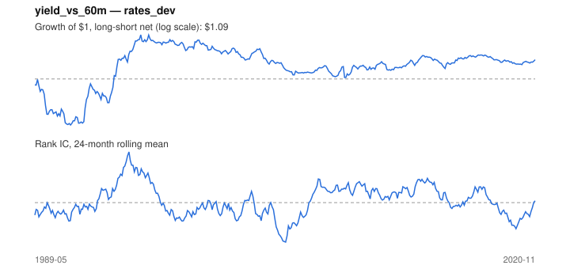

# Signal card: `yield_vs_60m`

10-year yield above its own 60-month average (cheap bonds). Universe: `rates_dev`, 1989-05 to 2020-11 (379 months), net of 10 bp per unit of turnover.

Verdict: **Not promoted** — passes 2 of 6 gates; fails ic_tstat, dsr, pbo, regimes.

## Why it should work

Cheap assets (high book-to-market) earn a premium, as compensation for distress risk or because investors over-extrapolate growth.

Reference: Asness, Moskowitz & Pedersen (2013), value in government bonds

## Data and timing

- Annual BE/ME for fiscal year y is used from the end of June y+1 (Fama-French).
- Source: Ken French data library (industry portfolios, factors), latest vintage.
- Parameters: `{'window': 60}`

## Results

| Metric | Value |
|---|---|
| Mean rank IC | 0.012 |
| IC t-stat (Newey-West) | 0.49 |
| IC information ratio (annual) | 0.10 |
| IC hit rate | 50% |
| Long-short return, annual, net | 0.4% |
| Long-short volatility, annual | 4.0% |
| Sharpe, gross / net | 0.23 / 0.09 |
| Sharpe since 2000, net | -0.13 |
| Probabilistic Sharpe (vs 0) | 0.69 |
| Deflated Sharpe (16 trials) | 0.00 |
| Turnover per month | 0.48 |
| Break-even cost | 16 bp |
| Quintile monotonicity | 1.00 |

IC decay (signal at t vs return k months later): 1m +0.012, 2m +0.010, 3m +0.000, 6m -0.012, 12m +0.010

Annual return by quantile: Q1 +2.7%, Q2 +3.6%, Q3 +3.6%

## Promotion gates (PRD §8.4)

| Gate | Threshold | Value | Result |
|---|---|---|---|
| IC t-stat | ≥ 2 | 0.49 | fail |
| Deflated Sharpe | ≥ 0.95 | 0.00 | fail |
| Family PBO | < 20% | 81% | fail |
| Regimes with IC > 0 | ≥ 3 of 4 | 2 of 4 | fail |
| Ensemble ICIR contribution | > 0 | +0.185 | pass |
| Economic rationale | reference | yes | pass |

IC by market regime: down_calm -0.024, down_volatile +0.087, up_calm +0.011, up_volatile -0.027

## Every configuration tried (`value` family)

PBO across 2 configurations: 81% over 379 common months.

| Configuration | IC | t-stat | Sharpe net | DSR |
|---|---|---|---|---|
| `yield_vs_36m` | 0.015 | 0.62 | 0.20 | 0.00 |
| `yield_vs_60m` | 0.012 | 0.49 | 0.09 | 0.00 |

## Tearsheet



## Where it breaks

- Worst drawdown: -19%, from Jul 1989 to Aug 1991.
- Worst 12 months: -14%, ending Jul 1990.
- Since 2000 the net Sharpe is -0.13 versus 0.09 over the full sample.

## Reproduce

```bash
uv run atlas ingest sdmx --agency oecd
uv run atlas research gates --universe rates_dev --exclude-holdout
uv run atlas research signal yield_vs_60m --universe rates_dev
```

_Generated by `atlas research cards` on 2026-10-21. Do not edit by hand._
