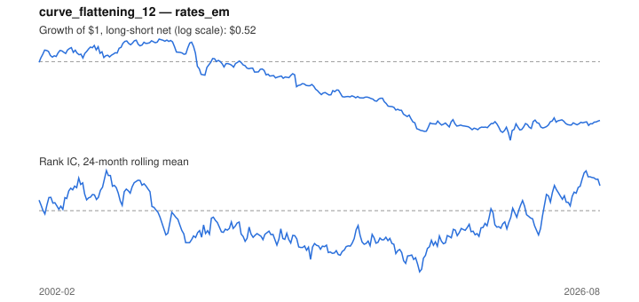

# Signal card: `curve_flattening_12`

Flattening of the 10Y-3M curve over 12 months. Universe: `rates_em`, 2002-02 to 2026-08 (291 months), net of 10 bp per unit of turnover.

Verdict: **Not promoted** — passes 2 of 6 gates; fails ic_tstat, dsr, pbo, regimes.

## Why it should work

No rationale recorded.

Reference: Cochrane & Piazzesi (2005) on the term structure of bond risk premia

## Data and timing

- Uses returns through the end of month t; the forecast is month t+1's return.
- Source: Ken French data library (industry portfolios, factors), latest vintage.
- Parameters: `{'months': 12}`

## Results

| Metric | Value |
|---|---|
| Mean rank IC | -0.042 |
| IC t-stat (Newey-West) | -1.57 |
| IC information ratio (annual) | -0.34 |
| IC hit rate | 47% |
| Long-short return, annual, net | -2.2% |
| Long-short volatility, annual | 10.0% |
| Sharpe, gross / net | -0.08 / -0.22 |
| Sharpe since 2000, net | -0.22 |
| Probabilistic Sharpe (vs 0) | 0.14 |
| Deflated Sharpe (13 trials) | 0.00 |
| Turnover per month | 1.19 |
| Break-even cost | -5 bp |
| Quintile monotonicity | -0.60 |

IC decay (signal at t vs return k months later): 1m -0.042, 2m -0.016, 3m -0.006, 6m -0.008, 12m -0.001

Annual return by quantile: Q1 +2.5%, Q2 +2.4%, Q3 +3.0%, Q4 -0.9%, Q5 +1.7%

## Promotion gates (PRD §8.4)

| Gate | Threshold | Value | Result |
|---|---|---|---|
| IC t-stat | ≥ 2 | -1.57 | fail |
| Deflated Sharpe | ≥ 0.95 | 0.00 | fail |
| Family PBO | < 20% | 88% | fail |
| Regimes with IC > 0 | ≥ 3 of 4 | 1 of 4 | fail |
| Ensemble ICIR contribution | > 0 | +0.002 | pass |
| Economic rationale | reference | yes | pass |

IC by market regime: down_calm -0.431, down_volatile +0.025, up_calm -0.042, up_volatile -0.062

## Every configuration tried (`curve_change` family)

PBO across 2 configurations: 88% over 291 common months.

| Configuration | IC | t-stat | Sharpe net | DSR |
|---|---|---|---|---|
| `curve_flattening_12` | -0.042 | -1.57 | -0.22 | 0.00 |
| `curve_flattening_6` | -0.031 | -1.36 | -0.28 | 0.00 |

## Tearsheet



## Where it breaks

- Worst drawdown: -67%, from May 2007 to Sep 2022.
- Worst 12 months: -24%, ending Jan 2009.
- Since 2000 the net Sharpe is -0.22 versus -0.22 over the full sample.

## Reproduce

```bash
uv run atlas ingest sdmx --agency oecd
uv run atlas research gates --universe rates_em --exclude-holdout
uv run atlas research signal curve_flattening_12 --universe rates_em
```

_Generated by `atlas research cards` on 2026-10-26. Do not edit by hand._
