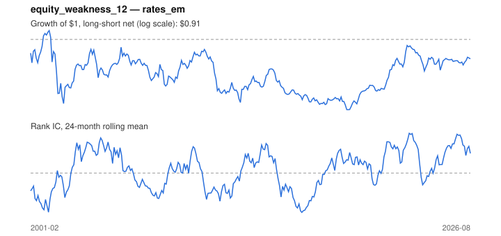

# Signal card: `equity_weakness_12`

Weak local equity market over 12 months (flight to quality). Universe: `rates_em`, 2001-02 to 2026-08 (305 months), net of 10 bp per unit of turnover.

Verdict: **Not promoted** — passes 2 of 6 gates; fails ic_tstat, dsr, pbo, regimes.

## Why it should work

No rationale recorded.

Reference: Baele, Bekaert & Inghelbrecht (2010), stock-bond return comovement

## Data and timing

- Uses returns through the end of month t; the forecast is month t+1's return.
- Source: Ken French data library (industry portfolios, factors), latest vintage.
- Parameters: `{'months': 12}`

## Results

| Metric | Value |
|---|---|
| Mean rank IC | 0.011 |
| IC t-stat (Newey-West) | 0.44 |
| IC information ratio (annual) | 0.10 |
| IC hit rate | 49% |
| Long-short return, annual, net | -0.0% |
| Long-short volatility, annual | 8.5% |
| Sharpe, gross / net | 0.13 / -0.00 |
| Sharpe since 2000, net | -0.00 |
| Probabilistic Sharpe (vs 0) | 0.49 |
| Deflated Sharpe (13 trials) | 0.01 |
| Turnover per month | 0.92 |
| Break-even cost | 10 bp |
| Quintile monotonicity | 0.30 |

IC decay (signal at t vs return k months later): 1m +0.011, 2m +0.006, 3m +0.009, 6m +0.006, 12m -0.001

Annual return by quantile: Q1 +0.9%, Q2 +2.3%, Q3 +1.9%, Q4 +1.8%, Q5 +2.0%

## Promotion gates (PRD §8.4)

| Gate | Threshold | Value | Result |
|---|---|---|---|
| IC t-stat | ≥ 2 | 0.44 | fail |
| Deflated Sharpe | ≥ 0.95 | 0.01 | fail |
| Family PBO | < 20% | n/a | fail |
| Regimes with IC > 0 | ≥ 3 of 4 | 2 of 4 | fail |
| Ensemble ICIR contribution | > 0 | +0.267 | pass |
| Economic rationale | reference | yes | pass |

IC by market regime: down_calm +0.023, down_volatile -0.033, up_calm +0.041, up_volatile -0.011

## Every configuration tried (`flight_to_quality` family)

PBO across 1 configurations: n/a over 0 common months.

| Configuration | IC | t-stat | Sharpe net | DSR |
|---|---|---|---|---|
| `equity_weakness_12` | 0.011 | 0.44 | -0.00 | 0.01 |

## Tearsheet



## Where it breaks

- Worst drawdown: -33%, from Mar 2002 to Jul 2019.
- Worst 12 months: -30%, ending Jan 2003.
- Since 2000 the net Sharpe is -0.00 versus -0.00 over the full sample.

## Reproduce

```bash
uv run atlas ingest sdmx --agency oecd
uv run atlas research gates --universe rates_em --exclude-holdout
uv run atlas research signal equity_weakness_12 --universe rates_em
```

_Generated by `atlas research cards` on 2026-10-26. Do not edit by hand._
