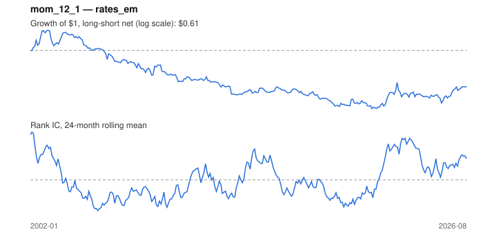

# Signal card: `mom_12_1`

12-month momentum skipping the last 1 month(s). Universe: `rates_em`, 2002-01 to 2026-08 (293 months), net of 10 bp per unit of turnover.

Verdict: **Not promoted** — passes 1 of 6 gates; fails ic_tstat, dsr, pbo, regimes, marginal.

## Why it should work

Investors under-react to industry news, so prices drift in the direction of recent performance; Moskowitz & Grinblatt find industry momentum explains much of stock-level momentum.

Reference: Jegadeesh & Titman (1993); Moskowitz & Grinblatt (1999), industry momentum

## Data and timing

- Uses returns through the end of month t; the forecast is month t+1's return.
- Source: Ken French data library (industry portfolios, factors), latest vintage.
- Parameters: `{'lookback': 12, 'skip': 1}`

## Results

| Metric | Value |
|---|---|
| Mean rank IC | 0.008 |
| IC t-stat (Newey-West) | 0.26 |
| IC information ratio (annual) | 0.06 |
| IC hit rate | 51% |
| Long-short return, annual, net | -1.5% |
| Long-short volatility, annual | 10.4% |
| Sharpe, gross / net | -0.00 / -0.14 |
| Sharpe since 2000, net | -0.14 |
| Probabilistic Sharpe (vs 0) | 0.25 |
| Deflated Sharpe (13 trials) | 0.00 |
| Turnover per month | 1.21 |
| Break-even cost | -0 bp |
| Quintile monotonicity | 0.00 |

IC decay (signal at t vs return k months later): 1m +0.008, 2m +0.007, 3m +0.003, 6m +0.001, 12m +0.016

Annual return by quantile: Q1 +0.7%, Q2 +1.0%, Q3 +3.1%, Q4 +3.7%, Q5 +0.7%

## Promotion gates (PRD §8.4)

| Gate | Threshold | Value | Result |
|---|---|---|---|
| IC t-stat | ≥ 2 | 0.26 | fail |
| Deflated Sharpe | ≥ 0.95 | 0.00 | fail |
| Family PBO | < 20% | 81% | fail |
| Regimes with IC > 0 | ≥ 3 of 4 | 2 of 4 | fail |
| Ensemble ICIR contribution | > 0 | -0.089 | fail |
| Economic rationale | reference | yes | pass |

IC by market regime: down_calm -0.025, down_volatile -0.043, up_calm +0.019, up_volatile +0.025

## Every configuration tried (`momentum` family)

PBO across 3 configurations: 81% over 293 common months.

| Configuration | IC | t-stat | Sharpe net | DSR |
|---|---|---|---|---|
| `mom_6_1` | 0.008 | 0.28 | -0.12 | 0.00 |
| `mom_12_1` | 0.008 | 0.26 | -0.14 | 0.00 |
| `mom_3_1` | -0.039 | -1.55 | -0.23 | 0.00 |

## Tearsheet



## Where it breaks

- Worst drawdown: -65%, from Jan 2003 to Apr 2021.
- Worst 12 months: -20%, ending May 2010.
- Since 2000 the net Sharpe is -0.14 versus -0.14 over the full sample.

## Reproduce

```bash
uv run atlas ingest sdmx --agency oecd
uv run atlas research gates --universe rates_em --exclude-holdout
uv run atlas research signal mom_12_1 --universe rates_em
```

_Generated by `atlas research cards` on 2026-10-26. Do not edit by hand._
