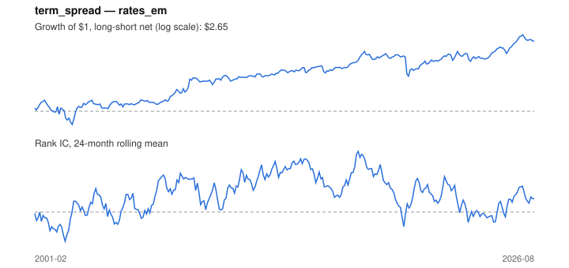

# Signal card: `term_spread`

10-year yield minus the 3-month rate (bond carry). Universe: `rates_em`, 2001-02 to 2026-08 (305 months), net of 10 bp per unit of turnover.

Verdict: **Not promoted** — passes 4 of 6 gates; fails dsr, pbo.

## Why it should work

No rationale recorded.

Reference: Koijen, Moskowitz, Pedersen & Vrugt (2018); Ilmanen (1995) on bond risk premia

## Data and timing

- Uses returns through the end of month t; the forecast is month t+1's return.
- Source: Ken French data library (industry portfolios, factors), latest vintage.
- Parameters: `{'smooth': 1}`

## Results

| Metric | Value |
|---|---|
| Mean rank IC | 0.082 |
| IC t-stat (Newey-West) | 3.07 |
| IC information ratio (annual) | 0.68 |
| IC hit rate | 57% |
| Long-short return, annual, net | 4.4% |
| Long-short volatility, annual | 10.6% |
| Sharpe, gross / net | 0.50 / 0.42 |
| Sharpe since 2000, net | 0.42 |
| Probabilistic Sharpe (vs 0) | 0.97 |
| Deflated Sharpe (13 trials) | 0.48 |
| Turnover per month | 0.69 |
| Break-even cost | 63 bp |
| Quintile monotonicity | 0.70 |

IC decay (signal at t vs return k months later): 1m +0.082, 2m +0.064, 3m +0.066, 6m +0.079, 12m +0.093

Annual return by quantile: Q1 +1.1%, Q2 -0.1%, Q3 +0.9%, Q4 +3.6%, Q5 +6.3%

## Promotion gates (PRD §8.4)

| Gate | Threshold | Value | Result |
|---|---|---|---|
| IC t-stat | ≥ 2 | 3.07 | pass |
| Deflated Sharpe | ≥ 0.95 | 0.48 | fail |
| Family PBO | < 20% | 91% | fail |
| Regimes with IC > 0 | ≥ 3 of 4 | 4 of 4 | pass |
| Ensemble ICIR contribution | > 0 | +0.507 | pass |
| Economic rationale | reference | yes | pass |

IC by market regime: down_calm +0.555, down_volatile +0.014, up_calm +0.084, up_volatile +0.100

## Every configuration tried (`carry` family)

PBO across 3 configurations: 91% over 293 common months.

| Configuration | IC | t-stat | Sharpe net | DSR |
|---|---|---|---|---|
| `term_spread` | 0.082 | 3.07 | 0.42 | 0.25 |
| `term_spread_avg_3` | 0.070 | 2.61 | 0.39 | 0.20 |
| `term_spread_avg_12` | 0.066 | 2.57 | 0.36 | 0.14 |

## Tearsheet



## Where it breaks

- Worst drawdown: -29%, from Dec 2017 to Mar 2020.
- Worst 12 months: -22%, ending Mar 2020.
- Since 2000 the net Sharpe is 0.42 versus 0.42 over the full sample.

## Reproduce

```bash
uv run atlas ingest sdmx --agency oecd
uv run atlas research gates --universe rates_em --exclude-holdout
uv run atlas research signal term_spread --universe rates_em
```

_Generated by `atlas research cards` on 2026-10-26. Do not edit by hand._
