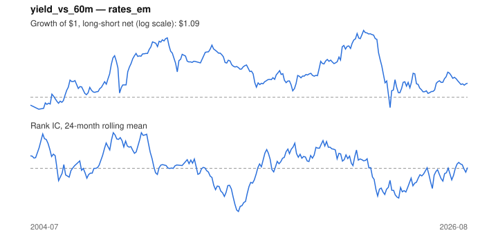

# Signal card: `yield_vs_60m`

10-year yield above its own 60-month average (cheap bonds). Universe: `rates_em`, 2004-07 to 2026-08 (253 months), net of 10 bp per unit of turnover.

Verdict: **Not promoted** — passes 2 of 6 gates; fails ic_tstat, dsr, pbo, regimes.

## Why it should work

Cheap assets (high book-to-market) earn a premium, as compensation for distress risk or because investors over-extrapolate growth.

Reference: Asness, Moskowitz & Pedersen (2013), value in government bonds

## Data and timing

- Annual BE/ME for fiscal year y is used from the end of June y+1 (Fama-French).
- Source: Ken French data library (industry portfolios, factors), latest vintage.
- Parameters: `{'window': 60}`

## Results

| Metric | Value |
|---|---|
| Mean rank IC | 0.010 |
| IC t-stat (Newey-West) | 0.32 |
| IC information ratio (annual) | 0.08 |
| IC hit rate | 50% |
| Long-short return, annual, net | 0.9% |
| Long-short volatility, annual | 10.0% |
| Sharpe, gross / net | 0.19 / 0.09 |
| Sharpe since 2000, net | 0.09 |
| Probabilistic Sharpe (vs 0) | 0.66 |
| Deflated Sharpe (13 trials) | 0.06 |
| Turnover per month | 0.82 |
| Break-even cost | 19 bp |
| Quintile monotonicity | 0.50 |

IC decay (signal at t vs return k months later): 1m +0.010, 2m -0.011, 3m -0.014, 6m +0.003, 12m -0.006

Annual return by quantile: Q1 +1.4%, Q2 -0.1%, Q3 +3.3%, Q4 +1.0%, Q5 +3.3%

## Promotion gates (PRD §8.4)

| Gate | Threshold | Value | Result |
|---|---|---|---|
| IC t-stat | ≥ 2 | 0.32 | fail |
| Deflated Sharpe | ≥ 0.95 | 0.06 | fail |
| Family PBO | < 20% | 37% | fail |
| Regimes with IC > 0 | ≥ 3 of 4 | 2 of 4 | fail |
| Ensemble ICIR contribution | > 0 | +0.123 | pass |
| Economic rationale | reference | yes | pass |

IC by market regime: down_calm -0.008, down_volatile +0.081, up_calm -0.022, up_volatile +0.034

## Every configuration tried (`value` family)

PBO across 2 configurations: 37% over 253 common months.

| Configuration | IC | t-stat | Sharpe net | DSR |
|---|---|---|---|---|
| `yield_vs_36m` | 0.048 | 1.47 | 0.29 | 0.18 |
| `yield_vs_60m` | 0.010 | 0.32 | 0.09 | 0.04 |

## Tearsheet



## Where it breaks

- Worst drawdown: -39%, from May 2021 to Sep 2022.
- Worst 12 months: -38%, ending Sep 2022.
- Since 2000 the net Sharpe is 0.09 versus 0.09 over the full sample.

## Reproduce

```bash
uv run atlas ingest sdmx --agency oecd
uv run atlas research gates --universe rates_em --exclude-holdout
uv run atlas research signal yield_vs_60m --universe rates_em
```

_Generated by `atlas research cards` on 2026-10-26. Do not edit by hand._
